# 0. 시작하기 전에

이 해커톤에서 팀은 문서를 입력받아 Upstage Studio 에이전트로 구조화하고 판단하는 서비스를 만듭니다. 이런 에이전트를 Document Agent라고 부릅니다.

본문에 나오는 HR AI Service는 이력서와 채용공고를 매칭하는 예시입니다. 팀은 같은 흐름을 따라 팀이 정한 문서와 주제로 서비스를 만듭니다.

## 0-1. 해커톤 개요

팀마다 PDF 문서를 입력받아 Studio 에이전트로 내용을 JSON으로 구조화하고, 비교와 판단을 거쳐 결과를 화면에 보여 주는 서비스를 만듭니다.

```TEXT
문서 입력 → Studio 에이전트(구조화, 판단) → Python 코드(조립) → 화면(결과 표시)
```

진행 순서는 다음과 같습니다. 최종 결과물은 인터넷에 공개된 팀 서비스입니다.

1. 팀 주제를 정하고 기획서 템플릿을 작성합니다.
2. Studio 에이전트를 만듭니다.
3. 스타터 코드에 에이전트를 연결하고 Streamlit 화면을 붙입니다.
4. Railway로 배포해 공개 URL을 만듭니다.

예시에서 바꾸는 것은 입력 문서, 추출 스키마, 판단 기준입니다. 에이전트, 코드, 화면으로 이어지는 구조는 그대로 둡니다.

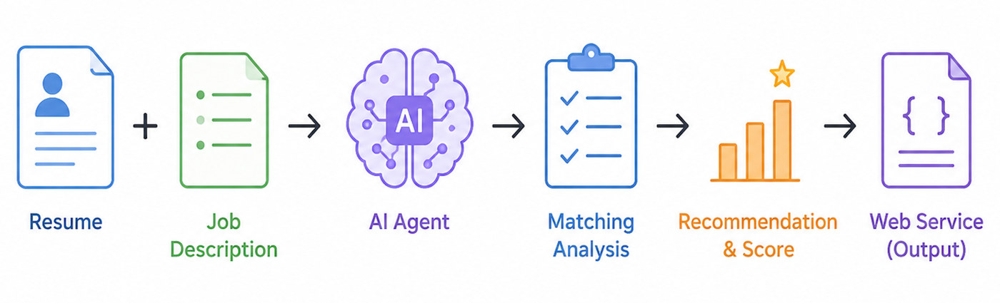

## 0-2. 사전 준비

### 계정

| 항목 | 용도 |
| --- | --- |
| Upstage Console 계정과 API Key | Studio 에이전트 호출 |
| Upstage Studio 접속 | 에이전트 생성, 실행, Agent ID 확인 |
| GitHub 계정 | 코드 저장, Railway 연결 |
| Railway 계정 | Streamlit 서비스 배포. GitHub 계정으로 로그인 |

API Key는 `.env` 파일에만 둡니다. 코드나 GitHub에 올리지 않습니다.

### 로컬 도구

| 소프트웨어 | 버전 | 용도 |
| --- | --- | --- |
| Python | 3.11 이상 | 스타터 코드 실행 |
| Git | 최신 | 코드 관리 |
| Visual Studio Code | 최신 | 개발 환경 |
| Google Chrome | 최신 | Streamlit 화면 확인 |

버전이 출력되면 준비된 것입니다.

```bash
python --version
git --version
```

로컬에서 Streamlit은 8501 포트를 씁니다.

### 스타터 코드

스타터 코드는 GitHub 저장소에서 받습니다. 저장소 루트가 본문의 `hr-ai-service-workflow/` 폴더와 같은 구성입니다.

[스타터 코드 저장소](https://github.com/SuWanKim-code/document-agent-hackathon-starter-code)

```bash
git clone https://github.com/SuWanKim-code/document-agent-hackathon-starter-code.git hr-ai-service-workflow
```

### 확인

- Upstage Console에서 API Key를 발급받았습니다.
- Upstage Studio에 접속해 빈 에이전트를 만들 수 있습니다.
- GitHub 계정이 있고 로컬에 Git이 설치되어 있습니다.
- `python --version` 이 3.11 이상입니다.

# 1. 프로젝트 이해

코드를 실행하기 전에 무엇을 만드는지, 어떤 기술이 어떻게 연결되는지 확인합니다.

## 1-1. 예시 서비스

채용 담당자는 지원자의 이력서와 채용공고를 비교해 적합한 인재를 찾는 일을 반복합니다. 시간이 많이 들고, 평가 기준이 사람마다 다릅니다.

HR AI Service는 이력서와 채용공고를 자동으로 분석하고 직무 적합도, 부족한 역량, 개선 사항을 제안합니다. 새 AI 모델을 만드는 것이 아니라, Studio 에이전트의 기능을 코드로 연결해 서비스로 구성합니다.

형식이 제각각인 문서를 에이전트가 처리하려면 세 가지가 필요합니다.

| 필요한 것 | 담당 |
| --- | --- |
| 문서를 JSON으로 구조화 | Studio 에이전트의 Parse, Extract 노드 |
| JSON을 조립해 다음 단계로 전달 | Python 코드 |
| 결과를 사용자에게 보여 주기 | Streamlit |

팀 주제가 계약서 검토, 논문 비교, 영수증 정산처럼 다른 문서여도 이 구조는 같습니다.

## 1-2. 최종 화면

사용자는 브라우저에서 Resume PDF와 Job Description PDF를 업로드하고 `Analyze` 버튼을 누릅니다. 내부에서는 에이전트 3개가 순서대로 실행되고 결과가 화면에 표시됩니다.

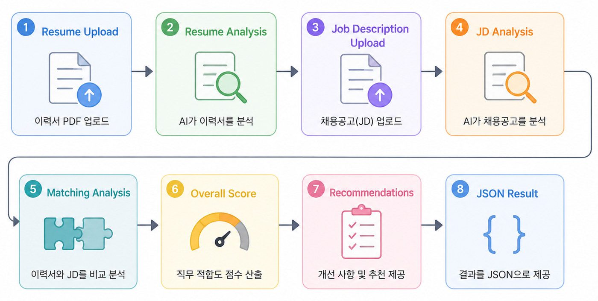


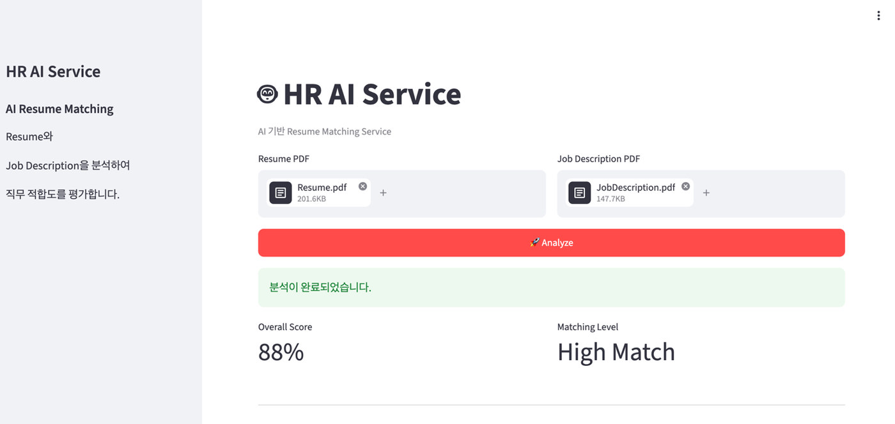

| 항목 | 내용 |
| --- | --- |
| Overall Score | 전체 적합도 점수. 0에서 100 사이 |
| Matching Level | High Match, Medium Match, Low Match 중 하나 |
| Summary | 전체 평가 요약 |
| Matched Skills, Missing Skills | 일치하는 기술, 부족한 기술 |
| Strengths, Weaknesses | 지원자의 강점, 보완점 |
| Recommendations | 개선과 학습 추천 사항 |
| JSON Result | 결과 JSON 표시와 다운로드 |

## 1-3. 기술 스택

| 영역 | 사용 기술 | 역할 |
| --- | --- | --- |
| Programming | Python 3.11 이상 | 프로젝트 전체 구현 |
| AI Platform | Upstage Studio 에이전트 API | 문서 분석 |
| AI SDK | OpenAI Python SDK | Upstage API 호출 |
| File Upload | Upstage Files API | PDF 업로드 후 File ID 발급 |
| Web Framework | Streamlit | 사용자 화면 |
| Document | ReportLab | Matching 입력 PDF 생성 |
| Data Format | JSON | 에이전트 간 데이터 전달과 저장 |
| Deployment | Railway | 클라우드 배포 |
| Version Control | Git, GitHub | 소스 관리, Railway 연동 |

Upstage API는 OpenAI SDK와 호환됩니다. `base_url` 을 Upstage 주소로 지정하면 Files API와 에이전트 실행을 같은 클라이언트로 호출합니다.

```python
OpenAI(api_key=..., base_url="https://api.upstage.ai/v2")
```

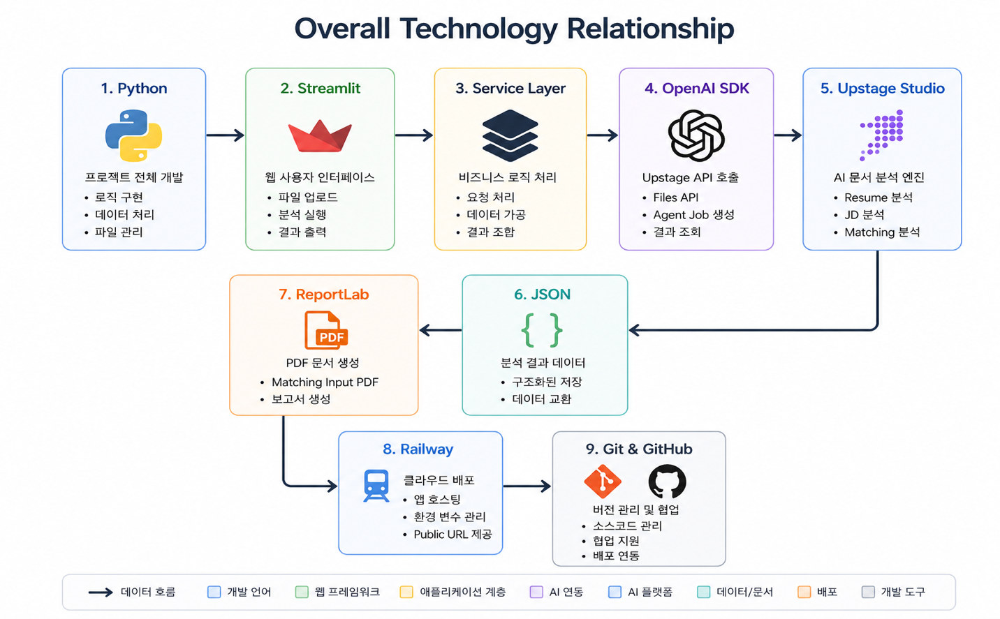

## 1-4. 5계층 아키텍처

프로젝트는 다섯 개의 계층으로 나뉘고, 각 계층은 하나의 책임만 맡습니다.

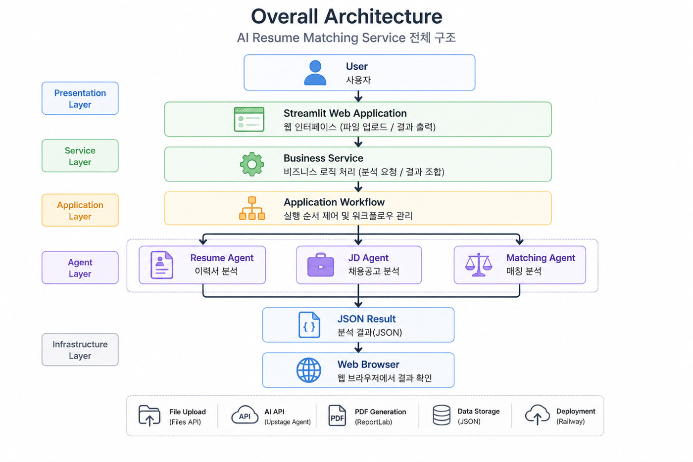

| 계층 | 역할 | 담당 파일 |
| --- | --- | --- |
| Presentation | 파일 업로드, 분석 요청, 결과 출력 | `streamlit_app.py` |
| Service | 화면과 워크플로우 사이의 비즈니스 로직 | `service.py` |
| Application | 에이전트 실행 순서 제어 | `app.py` |
| Agent | Studio 에이전트 호출, JSON 결과 수신 | `resume_agent.py`, `jd_agent.py`, `matching_agent.py`, `agent_client.py` |
| Infrastructure | 환경 설정, 파일 업로드, PDF 생성, 파일 입출력 | `config.py`, `upload.py`, `matching_builder.py`, `file_manager.py` |

기능을 추가하거나 오류를 고칠 때 어느 파일을 열어야 하는지가 이 표로 정해집니다.

## 1-5. 폴더 구조

스타터 코드 `hr-ai-service-workflow/` 의 구조입니다. 파일은 계층별 폴더 없이 루트에 놓여 있습니다.

```TEXT
hr-ai-service-workflow/
├── app.py
├── streamlit_app.py
├── service.py
├── config.py
├── upload.py
├── agent_client.py
├── resume_agent.py
├── jd_agent.py
├── matching_agent.py
├── matching_builder.py
├── file_manager.py
├── requirements.txt
├── README.md
├── .gitignore
├── .env.example
├── agent_configs/
│   ├── Resume Agent.json
│   ├── JD Agent.json
│   └── Matching Agent.json
├── fonts/
│   └── NanumGothic-Regular.ttf
├── data/
│   ├── Resume.pdf
│   └── JobDescription.pdf
├── output/
│   ├── resume.json
│   ├── jd.json
│   └── Matching_Input.pdf
└── result/
    └── matching_result.json
```

| 파일, 폴더 | 역할 |
| --- | --- |
| `app.py` | 전체 워크플로우 실행. Resume 분석, JD 분석, Matching PDF 생성, Matching 분석 순서 |
| `streamlit_app.py` | 파일 2개를 업로드받아 `service.py` 를 호출하고 결과를 출력 |
| `service.py` | 4단계를 `run_matching_service()` 함수 하나로 제공 |
| `config.py` | API Key, Agent ID, Config ID, 파일 경로, 폰트 설정 |
| `upload.py` | Files API로 PDF를 업로드하고 File ID 반환 |
| `agent_client.py` | 에이전트 공통 호출 클래스. Job 생성, 상태 조회, JSON 파싱 |
| `resume_agent.py`, `jd_agent.py`, `matching_agent.py` | 각 에이전트를 호출해 JSON 결과 생성 |
| `matching_builder.py` | `resume.json` 과 `jd.json` 으로 `Matching_Input.pdf` 생성 |
| `file_manager.py` | JSON 저장과 읽기 |
| `agent_configs/` | Studio에서 내보낸 에이전트 설정 JSON. 스키마를 만들 때 정답지로 사용 |
| `fonts/` | PDF 한글 출력용 나눔고딕 폰트 |
| `data/` | 샘플 입력 문서 |
| `output/` | 중간 산출물 |
| `result/` | 최종 결과 |
| `.env.example` | 환경변수 양식. 복사해서 `.env` 를 만듭니다 |

## 1-6. 전체 실행 흐름

사용자는 파일 업로드와 버튼 클릭만 하지만, 내부에서는 다음 순서로 데이터가 흐릅니다.

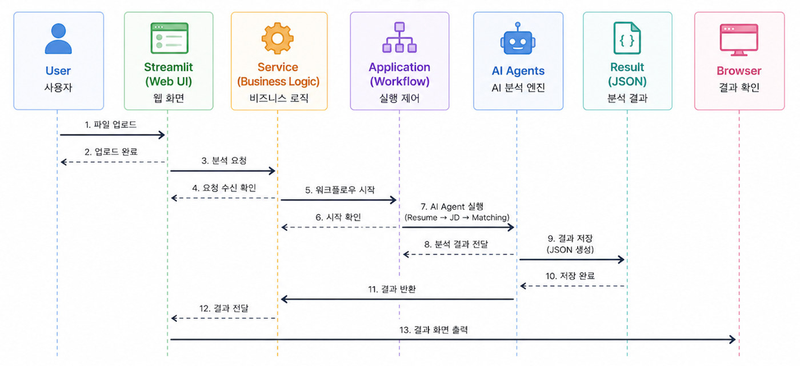

```TEXT
Resume.pdf → [Resume Agent] → resume.json ─┐
                                            ├→ [matching_builder.py] → Matching_Input.pdf → [Matching Agent] → matching_result.json
JobDescription.pdf → [JD Agent] → jd.json ─┘
```

| 단계 | 입력 | 처리 | 출력 |
| --- | --- | --- | --- |
| Step 1 | `data/Resume.pdf` | Resume Agent. Parse, Extract | `output/resume.json` |
| Step 2 | `data/JobDescription.pdf` | JD Agent. Parse, Extract | `output/jd.json` |
| Step 3 | `resume.json`, `jd.json` | `matching_builder.py` | `output/Matching_Input.pdf` |
| Step 4 | `Matching_Input.pdf` | Matching Agent. Parse, Classify, Extract | `result/matching_result.json` |

데이터는 PDF, JSON, PDF, JSON 순서로 모양을 바꿉니다. Studio 에이전트는 문서 파일만 입력받으므로, 두 JSON을 비교하려면 코드가 PDF 한 장으로 다시 조립해서 넘겨야 합니다.

Studio 에이전트가 문서를 JSON으로 바꾸고, 코드가 JSON을 조립해 다음 에이전트에 넘깁니다. 팀 주제로 바꿀 때도 이 패턴은 그대로 유지됩니다.

# 2. 개발 환경과 코드 흐름

개발 환경을 준비하고 실행 흐름을 따라 스타터 코드를 읽습니다. `python app.py` 는 Agent ID가 있어야 실행되므로, 실제 실행은 4-6에서 합니다.

지금 `python app.py` 를 실행하면 `다음 환경변수가 설정되지 않았습니다.` 오류로 멈춥니다. `config.py` 의 `validate_config()` 가 Agent ID를 검사하기 때문이며 정상 동작입니다.

## 2-1. Python과 가상환경

스타터 코드 폴더로 이동한 뒤 Python 버전을 확인합니다.

```bash
cd hr-ai-service-workflow
python --version
```

프로젝트 전용 가상환경을 만들고 활성화합니다.

```bash
python -m venv .venv
```

| OS | 활성화 명령 |
| --- | --- |
| Windows | `.venv\Scripts\activate` |
| macOS, Linux | `source .venv/bin/activate` |

활성화되면 터미널 앞에 `(.venv)` 가 표시됩니다. 이 상태에서 패키지를 설치합니다.

```bash
pip install -r requirements.txt
```

| 패키지 | 용도 |
| --- | --- |
| streamlit | 웹 화면 |
| openai | Upstage API 호출 |
| python-dotenv | `.env` 파일 읽기 |
| reportlab | Matching 입력 PDF 생성 |
| Pillow | ReportLab 이미지 지원 |
| requests | HTTP 클라이언트. 확장용 |

`ModuleNotFoundError` 가 나면 대부분 가상환경이 활성화되지 않은 상태입니다. `(.venv)` 표시를 먼저 확인합니다.

## 2-2. .env 만들기

API Key와 Agent ID는 코드에 쓰지 않고 `.env` 파일로 관리합니다. `.env.example` 을 복사해 `.env` 를 만듭니다. Windows에서는 `copy .env.example .env` 를 사용합니다.

```bash
cp .env.example .env
```

| 변수 | 값 | 채우는 시점 |
| --- | --- | --- |
| `UPSTAGE_API_KEY` | Upstage Console API Key | 지금 |
| `RESUME_AGENT_ID`, `RESUME_CONFIG_ID` | Resume Agent ID, 1 | 4-5 |
| `JD_AGENT_ID`, `JD_CONFIG_ID` | JD Agent ID, 1 | 4-5 |
| `MATCHING_AGENT_ID`, `MATCHING_CONFIG_ID` | Matching Agent ID, 1 | 4-5 |

지금은 `UPSTAGE_API_KEY` 만 채웁니다. `CONFIG_ID` 는 1을 그대로 둡니다.

`.env` 는 `.gitignore` 에 포함되어 GitHub에 올라가지 않습니다. `.env.example` 에는 실제 키를 쓰지 않습니다.

## 2-3. 실행 흐름 따라 코드 읽기

파일 이름 순서가 아니라 데이터가 이동하는 순서로 읽습니다.

```TEXT
app.py → resume_agent.py → agent_client.py → upload.py → matching_builder.py → config.py
```

### app.py

`main()` 은 네 단계를 순서대로 호출합니다. 각 단계가 실패하면 `None` 을 돌려주고 멈춥니다.

| 함수 | 하는 일 |
| --- | --- |
| `validate_config()`, `print_config()` | 환경변수 검사, 폴더 생성, 설정 출력 |
| `process_document()` | PDF 업로드, 에이전트 실행, JSON 저장. Step 1과 Step 2가 공유 |
| `build_matching_pdf()` | Step 3. Matching 입력 PDF 생성 |
| `process_matching()` | Step 4. PDF 업로드, Matching Agent 실행, 결과 저장 |
| `print_result()` | 생성된 파일 4개 경로 출력 |

### 에이전트 모듈과 agent_client.py

`resume_agent.py` 는 `AgentClient` 에 Agent ID와 Config ID를 넘겨 객체를 만들고, `analyze_resume(file_id)` 가 `run()` 을 호출합니다. `jd_agent.py` 와 `matching_agent.py` 는 ID 변수와 출력 문구만 다르고 구조가 같습니다.

| 메서드 | 역할 |
| --- | --- |
| `create_job(file_id)` | 에이전트 실행 요청. `client.responses.create(model=agent_id, ...)` |
| `wait_until_complete(job_id)` | 상태가 `queued`, `in_progress` 인 동안 2초 간격으로 조회 |
| `parse_result(response)` | `output_text` 를 JSON으로 변환 |
| `run(file_id)` | 위 세 단계를 순서대로 실행 |

`model=` 자리에 Studio Agent ID가 들어갑니다. Agent ID만 바꾸면 같은 클래스로 어떤 에이전트든 호출할 수 있습니다.

### upload.py

에이전트에 넘기는 `file_id` 는 `upload.py` 가 만듭니다. Files API에 PDF를 올리면 File ID가 돌아옵니다.

### matching_builder.py

두 JSON을 읽어 A4 PDF 한 장으로 만듭니다.

| 함수 | 역할 |
| --- | --- |
| `load_json(path)` | `resume.json`, `jd.json` 읽기 |
| `add_title`, `add_heading`, `add_text`, `add_list` | PDF에 제목, 소제목, 본문, 목록 추가 |
| `group_items(data, **fields)` | `company`, `career_position`, `career_period` 처럼 나뉜 리스트를 같은 순서끼리 묶음 |
| `add_resume(story, resume)` | Resume 섹션 출력. 경력, 프로젝트, 학력은 `group_items()` 로 묶음 |
| `add_job_description(story, jd)` | JD 섹션 출력 |
| `create_matching_input()` | 위 함수를 순서대로 호출해 `output/Matching_Input.pdf` 저장 |

### config.py

`.env` 를 읽어 상수로 만들고 파일 경로를 한곳에 정의합니다.

| 상수 | 값 |
| --- | --- |
| `UPSTAGE_API_KEY`, `*_AGENT_ID`, `*_CONFIG_ID` | `.env` 에서 `os.getenv()` 로 읽음 |
| `DATA_DIR`, `OUTPUT_DIR`, `RESULT_DIR` | `data/`, `output/`, `result/` |
| `RESUME_FILE`, `JD_FILE` | `data/Resume.pdf`, `data/JobDescription.pdf` |
| `RESUME_JSON`, `JD_JSON`, `MATCHING_PDF`, `MATCHING_RESULT` | 중간 산출물과 최종 결과 경로 |
| `FONT_NAME`, `FONT_PATH` | `Nanum`, `fonts/NanumGothic-Regular.ttf` |

팀 에이전트를 연결할 때 `config.py` 의 파일 경로와 `matching_builder.py` 의 필드 이름을 직접 고칩니다.

## 2-4. 결과 파일

스타터 코드의 `output/` 과 `result/` 에는 샘플 실행 결과가 들어 있습니다. 실행하면 같은 이름으로 덮어써집니다.

| 파일 | 위치 | 만드는 주체 | 역할 |
| --- | --- | --- | --- |
| `resume.json` | `output/` | Resume Agent | 이력서 분석 결과 |
| `jd.json` | `output/` | JD Agent | 채용공고 분석 결과 |
| `Matching_Input.pdf` | `output/` | `matching_builder.py` | 두 JSON을 합친 Matching 입력 문서 |
| `matching_result.json` | `result/` | Matching Agent | 최종 적합도 분석 결과 |

샘플 `output/Matching_Input.pdf` 는 4-4에서 Matching Agent를 만들 때 업로드용 문서로 씁니다.

### 확인

- `(.venv)` 상태에서 `pip install -r requirements.txt` 가 오류 없이 끝났습니다.
- `.env` 에 `UPSTAGE_API_KEY` 가 들어 있고, `git status` 에 `.env` 가 보이지 않습니다.
- `agent_client.py` 에서 Agent ID가 들어가는 인자를 찾았습니다.
- `output/Matching_Input.pdf` 를 열어 봤습니다.

# 3. 프로젝트 기획

코드를 열기 전에 무슨 문제를, 누구를 위해, 어떤 문서 처리로 푸는지 정합니다. 3-1부터 3-6까지는 HR 예시로 기획 과정을 보여 주고, 3-7에서 같은 과정을 팀 주제로 기획서 템플릿에 옮깁니다.

## 3-1. 문제 정의

문제 상황, 영향을 받는 사람, 만들 서비스를 한 줄씩 적습니다.

| 질문 | HR 예시 |
| --- | --- |
| 어떤 불편함인가 | 채용 담당자가 지원자마다 이력서와 채용공고를 대조해 적합도를 판단한다. 형식이 제각각이라 오래 걸리고 기준이 사람마다 다르다 |
| 누구에게 영향을 미치나 | 채용 담당자는 반복 검토로 업무 부담이 크다. 지원자는 어떤 역량이 부족한지 피드백을 받지 못한다 |
| 무엇을 만드나 | 이력서와 채용공고 PDF를 올리면 적합도 점수, 부족한 기술, 개선 추천을 보여 주는 서비스 |

비즈니스 임팩트도 함께 봅니다. HR 예시에서는 문서 1건당 에이전트 호출이 3회입니다. 채용 담당자는 검토 시간을 줄이고, 지원자는 부족 역량 피드백을 받고, 기업은 일관된 평가 기준을 얻습니다.

## 3-2. Studio 노드의 역할

문제가 Studio 문서 처리 워크플로우로 풀리는지 판단합니다. Studio 에이전트는 노드 4종을 이어 붙인 파이프라인입니다.

| 노드 | 하는 일 | 잘 맞는 문제 |
| --- | --- | --- |
| Parse | 문서를 텍스트로 바꾸면서 제목, 문단, 표, 목록 같은 구조를 함께 읽습니다 | 입력이 문서 파일인 모든 경우. 표와 서식이 많은 문서 |
| Classify | 문서를 정해 둔 분류 중 하나로 판정하고, 결과에 따라 다음 노드를 분기합니다 | 문서 종류나 등급에 따라 처리가 달라져야 할 때 |
| Extract | 정한 스키마대로 문서 안의 정보를 JSON으로 뽑습니다. 단일 값, 반복 항목, 요약문 모두 가능합니다 | 사람이 문서를 읽고 표에 옮겨 적던 일 |
| Instruct | 문서 내용을 근거로 LLM에 자유로운 지시를 내립니다. 정해진 스키마 없이 자연어 결과를 받습니다 | 형식이 정해지지 않은 판단이나 서술형 결과가 필요할 때 |

Studio 워크플로우가 잘 맞는 문제는 사람이 문서를 읽고, 옮겨 적고, 분류하고, 비교하는 반복 작업입니다. 자유 대화형 챗봇, 실시간 정보 검색, 문서가 없는 예측 문제는 Studio만으로 부족합니다.

HR 예시에서 이력서를 텍스트로 바꾸는 일은 Parse, 이름과 기술과 경력 추출은 Extract가 맡습니다. 적합도를 High, Medium, Low로 나누는 일은 Classify, 점수와 추천 생성은 분류별 Extract가 맡습니다.

## 3-3. 태스크 유형

서비스의 주요 기능을 업무 프로세스로 나누고 각 단계에 맞는 태스크 유형을 고릅니다.

| 태스크 유형 | 설명 | Studio에서 |
| --- | --- | --- |
| Key Extraction | 이름, 날짜, 금액 같은 항목을 뽑습니다 | Extract 노드 |
| Classification | 문서를 정해진 종류로 나눕니다 | Classify 노드 |
| Summarization | 핵심 내용을 간결하게 만듭니다 | Extract 스키마의 요약 항목 또는 Instruct 노드 |
| Comparison | 문서 간 같은 점과 다른 점을 찾습니다 | 문서별 JSON을 합친 뒤 Classify와 Extract |
| Generation | 문서를 근거로 추천이나 피드백을 만듭니다 | Extract 스키마의 추천 항목 또는 Instruct 노드 |
| Q&A | 문서 내용에 대해 자유롭게 묻고 답합니다 | Studio 밖에서 별도 구현 |

HR 예시의 업무 프로세스와 태스크 대응입니다.

```TEXT
1. 이력서를 읽는다            → Parse, Extract     = Resume Agent
2. 채용공고를 읽는다          → Parse, Extract     = JD Agent
3. 둘을 나란히 놓고 대조한다  → 두 JSON을 한 PDF로 합친다 (코드)
4. 적합도를 판단한다          → Parse, Classify    = Matching Agent
5. 점수, 부족 기술, 추천을 쓴다 → 분류별 Extract
6. 사람이 바로 확인한다       → Streamlit 화면
```

## 3-4. 데이터 요구사항

설계 전에 데이터 준비 상태를 점검합니다.

| 질문 | HR 예시 |
| --- | --- |
| 원천데이터 유형 | 이력서, 채용공고. 도메인은 채용과 인사 |
| 형식 | PDF 2종. 스타터의 `data/Resume.pdf`, `data/JobDescription.pdf` |
| 소스 | 팀원이 직접 만든 가상 이력서, 공개 채용공고 |
| 품질 | 형식이 다른 이력서 여러 장으로 테스트해 Extract 스키마가 모두 채워지는지 확인 |

:::note 개인정보가 담긴 문서
실제 개인의 이력서, 진료 기록, 계약서처럼 개인정보나 기밀이 들어 있는 문서는 데이터로 쓰지 않습니다. 가상 데이터를 만들거나 공개된 문서를 씁니다.
:::

## 3-5. 같은 패턴의 주제

HR 예시는 문서 2개를 Studio로 구조화하고, 코드로 합쳐서, 세 번째 에이전트로 비교하고 평가하는 패턴입니다. 팀 주제도 이 패턴에 올리면 스타터 코드를 거의 그대로 쓸 수 있습니다.

```TEXT
문서 A → [에이전트 A] → a.json ─┐
                                ├→ [코드로 조립] → input.pdf → [평가 에이전트] → result.json → 화면
문서 B → [에이전트 B] → b.json ─┘
```

| 주제 | 문서 A | 문서 B | 평가 에이전트가 하는 일 |
| --- | --- | --- | --- |
| HR 매칭 | 이력서 | 채용공고 | 적합도 분류, 강점과 보완점 |
| 계약서 검토 | 계약서 초안 | 사내 표준 계약 조건 | 위험 조항 분류, 수정 제안 |
| 논문 비교 | 논문 1 | 논문 2 | 방법과 결과 비교, 차이점 정리 |
| 영수증 정산 | 영수증 묶음 | 지출 규정 | 규정 위반 여부 분류, 정산 요약 |
| 제안서 평가 | 제안서 | 제안요청서 | 요구사항 충족도 분류, 누락 항목 |

## 3-6. HR 기획서 예시

HR 예시를 기획서 템플릿 항목에 맞춰 채운 모습입니다. 팀 기획서를 쓸 때 답을 얼마나 구체적으로 써야 하는지 보는 기준으로 씁니다.

| 항목 | HR AI Service 기획서 |
| --- | --- |
| 서비스명 및 개요 | HR AI Service. 이력서와 채용공고를 PDF로 올리면 Studio 에이전트가 두 문서를 구조화하고 적합도를 평가해 점수, 일치 기술, 부족 기술, 추천을 보여 준다. 채용 담당자의 반복 검토를 줄이고 지원자에게 구체적인 피드백을 준다 |
| 목표 및 기대효과 | 업로드 후 1분 안에 결과 제공, 평가 항목 10개를 일정한 형식으로 출력. 검토 시간 단축, 평가 기준 일관성, 지원자 피드백 품질 향상 |
| 타겟 사용자 | 여러 지원자를 같은 기준으로 검토하려는 채용 담당자, 목표 공고 대비 부족한 역량을 확인하려는 취업 준비생 |
| 데이터 구성 및 처리 방법 | 원천데이터는 이력서 PDF와 채용공고 PDF. Parse로 텍스트화, Extract로 JSON 변환, 두 JSON을 합친 PDF를 Classify와 분류별 Extract로 평가 |
| 에이전트 구성 | Resume Agent, JD Agent, Matching Agent. 코드는 업로드, 호출, JSON 조립, 화면 표시만 담당 |
| 화면 | 업로드 2개와 `Analyze` 버튼. 점수, 등급, 요약, 기술 목록, 강점과 약점, 추천, JSON 다운로드 |

기획서의 에이전트 구성 행이 4장에서 만들 에이전트 목록이 됩니다. 항목 하나가 에이전트 하나, 스키마 하나로 이어지도록 적으면 구현이 빨라집니다.

## 3-7. 내 해커톤에 적용하기

3-6의 HR 기획서 예시를 참고해 팀만의 프로젝트 기획서를 작성합니다. 결과물은 기획서 한 부이고, 4장부터 에이전트와 코드를 만들 때 이 기획서가 출발점이 됩니다.

[기획서 템플릿 내려받기](project-plan-template.docx)

### 기획서 템플릿 구성

템플릿은 네 항목으로 되어 있습니다. 각 항목을 채울 때 참고할 절을 함께 적었습니다.

| 템플릿 항목 | 적을 내용 | 참고 |
| --- | --- | --- |
| 서비스명 및 개요 | 서비스 이름, 해결하려는 문제, 주요 기능과 가치, 타겟 사용자와 사용 시나리오 | 3-1 |
| 목표 및 기대효과 | 측정 가능한 서비스 목표, 사용자에게 주는 이점, 조직과 사회에 기여하는 부분 | 3-1 |
| 타겟 사용자 | 예상 사용자 유형, 주요 요구사항과 사용 목적 | 3-1 |
| 데이터 구성 및 처리 방법 | 원천데이터 소스와 형식, 데이터 수집 방법, 데이터 처리 방법 | 3-2, 3-3, 3-4 |

템플릿 네 항목 뒤에 에이전트 구성과 화면 항목을 덧붙이는 것을 권장합니다. 7-1의 필수 요건에 두 항목이 포함되어 있습니다.

### 주제 정하기

- 구조화할 문서 2개가 있는가.
- 두 문서를 비교하거나 결합해서 내릴 판단이 있는가.
- 3-5의 패턴에 문서 A, 문서 B, 평가 에이전트를 채울 수 있는가.

### 문제 정의

- 어떤 불편함이나 비효율을 개선하고 싶은가. 문서를 사람이 반복해서 읽고 옮겨 적는 일이 있는가.
- 이 문제는 누구에게 영향을 미치는가.
- 무엇을 만들 것인가.
- 얻는 이익이 비용과 시간에 비해 충분한가. 사용자, 기업, 사회는 어떤 가치를 얻는가.

### Studio로 풀리는지 확인

- 입력이 문서인가. 그렇다면 Parse 노드가 필요합니다.
- 문서 종류나 등급에 따라 처리가 달라지는가. 그렇다면 Classify 노드로 분기합니다.
- 출력이 정해진 JSON 형식이어야 하는가. 그렇다면 Extract 노드의 스키마로 고정합니다.
- 문서를 근거로 요약, 평가, 비교가 필요한가. Instruct 노드를 쓰거나 결과 JSON을 합쳐 다시 입력하는 에이전트를 둡니다.
- 업무 프로세스를 단계별로 적고, 각 단계를 3-3의 태스크 유형에 대응시켰는가.

### 데이터 준비

- 필요한 문서는 무엇이고 형식은 무엇인가. Parse 노드가 읽을 수 있는 형식으로 바꿀 수 있는가.
- 문서를 구할 출처가 명확한가. 라이선스와 개인정보 문제가 없는가.
- 서로 다른 샘플 문서를 3개 이상 준비할 수 있는가.

### 팀 기획 요약

기획서를 쓰기 전에 아래 표를 한 문장씩 채우면 기획서의 뼈대가 됩니다.

| 항목 | HR 예시 | 팀 주제 |
| --- | --- | --- |
| 문제 정의 | 이력서와 채용공고 대조가 오래 걸리고 기준이 일정하지 않다 | |
| 기대 솔루션 | 두 문서를 Studio로 구조화하고 적합도, 부족 기술, 추천을 자동 생성 | |
| 태스크 유형 | Key Extraction, Classification, Comparison, Generation | |
| 데이터셋 | 이력서 PDF, 채용공고 PDF. 가상 문서와 공개 문서 | |
| 에이전트 구성 | Resume Agent, JD Agent, Matching Agent | |

# 4. Studio 에이전트 만들기

Upstage Studio에서 에이전트 3개를 만들고, Agent ID를 `.env` 에 넣은 뒤 `python app.py` 로 전체 흐름을 실행합니다. 에이전트는 코드 없이 화면에서 노드를 연결하고 스키마를 정의해 만듭니다.

## 4-1. 에이전트 구성

| 에이전트 | 입력 문서 | 노드 구성 | 출력 | Studio 템플릿 |
| --- | --- | --- | --- | --- |
| Resume Agent | `data/Resume.pdf` | Parse, Extract | `resume.json` | 문서 정보 추출 |
| JD Agent | `data/JobDescription.pdf` | Parse, Extract | `jd.json` | 문서 정보 추출 |
| Matching Agent | `output/Matching_Input.pdf` | Parse, Classify, Extract | `matching_result.json` | 문서 분류 후 정보 추출 |

세 에이전트는 같은 순서로 만듭니다.

```TEXT
에이전트 만들기 → 이름 지정 → 문서 업로드와 자동 설정 → 노드 확인 → Extract 스키마 설계 → 실행 → 결과 JSON 확인 → Agent ID 복사
```

스키마 필드 이름의 정답은 `agent_configs/*.json` 에 있습니다. `matching_builder.py` 와 `streamlit_app.py` 가 이 이름을 그대로 읽으므로 오타 없이 같은 이름을 씁니다.

4-1부터 4-7까지는 HR 예시의 에이전트 3개를 만들고 실행합니다. 팀 문서용 에이전트 설계와 코드 수정은 4-8에서 다룹니다.

## 4-2. Resume Agent

Resume Agent는 이력서 PDF에서 이름, 연락처, 기술, 경력, 프로젝트, 학력을 뽑아 `resume.json` 을 만듭니다.

### 만들기

1. Upstage Studio에서 `에이전트 만들기` 를 선택합니다.
2. 템플릿 화면에서 `문서 정보 추출` 을 선택합니다.
3. 에이전트 이름을 `Resume Agent` 로 바꿉니다.
4. `업로드` 로 `data/Resume.pdf` 를 올리고 `자동 설정` 을 선택합니다. Studio가 문서를 분석해 Parse 노드와 기본 Extract 스키마를 만듭니다.
5. 에이전트 편집기에서 `변환` 노드와 `Extract-1` 노드가 연결되어 있는지 확인합니다. Parse 노드는 따로 설정하지 않습니다.

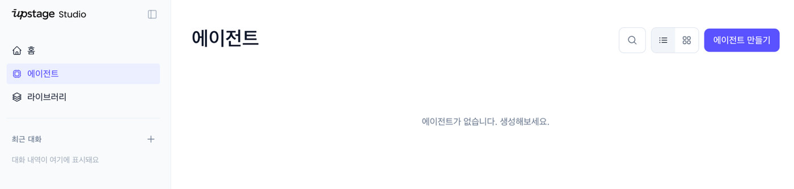

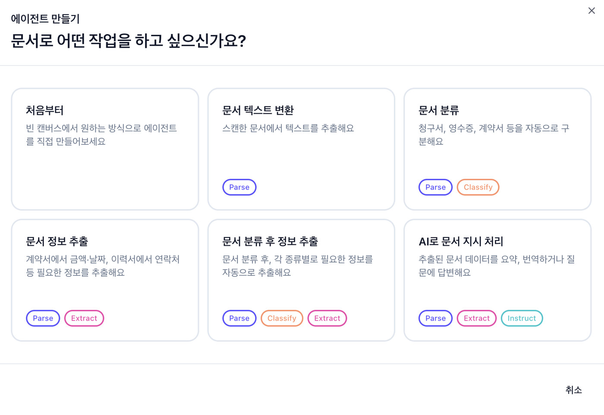

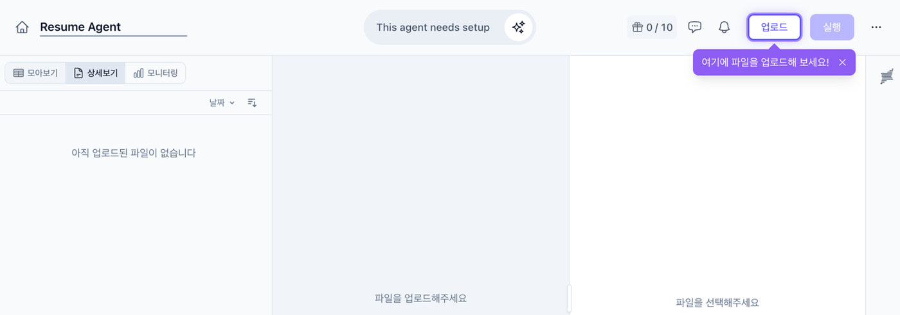

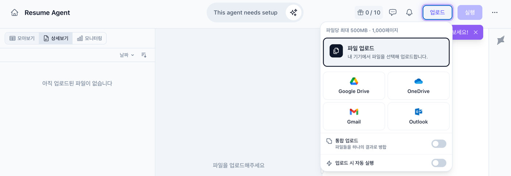

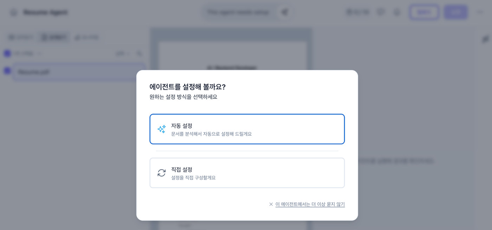

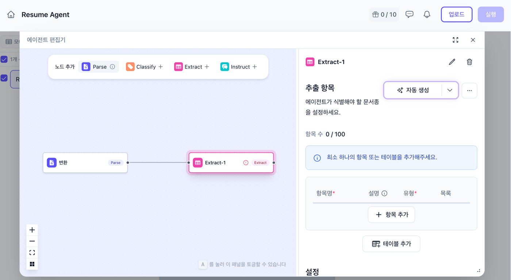

### Extract 스키마

`Extract-1` 노드를 선택하고 오른쪽 패널에서 항목을 아래 표와 같이 맞춥니다. 자동 설정이 만든 항목은 이름이 다를 수 있으니 표 기준으로 수정하고 추가합니다. 유형은 모두 String, 목록은 모두 켭니다.

| 항목명 | 설명 |
| --- | --- |
| `name` | 지원자의 이름 |
| `email` | 이메일주소 |
| `phone` | 휴대폰번호 |
| `location` | 거주 지역 |
| `position` | 지원 직무 |
| `summary` | 이력서 전체를 2~3문장으로 요약한 내용 |
| `skills` | 기술 스택목록 |
| `company` | 경력 회사명 |
| `career_position` | 경력 직무 |
| `career_period` | 근무 기간 |
| `career_description` | 주요 업무 요약 |
| `project_name` | 프로젝트명 |
| `project_period` | 프로젝트 수행 기간 |
| `project_description` | 프로젝트 설명 |
| `project_skills` | 프로젝트에서 사용한 기술 목록 |
| `school` | 학교명 |
| `major` | 전공명 |
| `education_period` | 재학 기간 |
| `certifications` | 자격증 목록 |
| `core_competencies` | 핵심역량 |

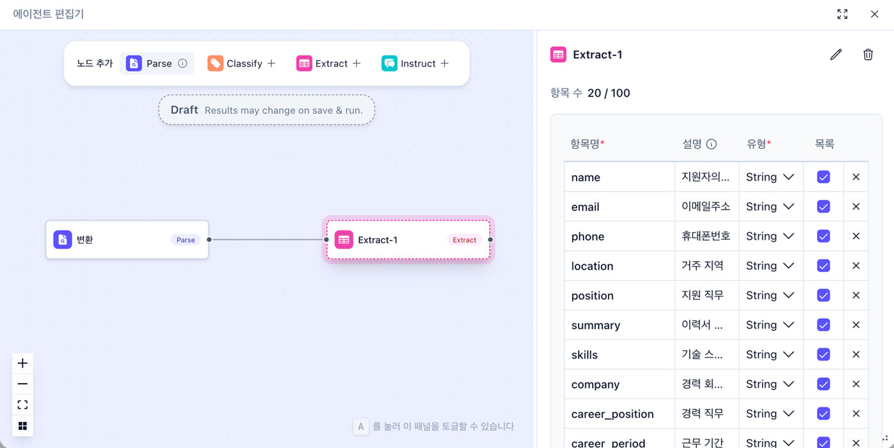

여러 개가 있을 수 있는 정보를 하나의 문자열로 저장하면 비교가 어렵습니다. 그래서 반복 가능한 항목은 목록으로 정의합니다.

설명 칸은 AI에게 주는 힌트입니다. 기술명은 대표 명칭으로 통일하고, 날짜 형식은 일관되게, 핵심 역량은 3~6개로 제한하도록 적으면 JSON 품질이 좋아집니다.

### 실행과 API 정보

오른쪽 위 `실행` 버튼을 누릅니다. 결과 패널의 `JSON` 탭에서 스키마대로 채워진 결과를 확인합니다.

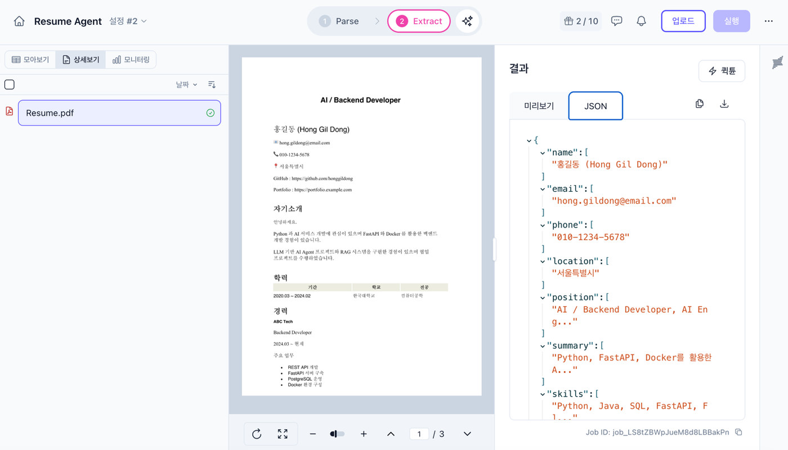

에이전트 화면 오른쪽 위 메뉴에서 `API로 이용하기` 를 엽니다. `agt_` 로 시작하는 Agent ID와 Config ID를 복사해 둡니다.

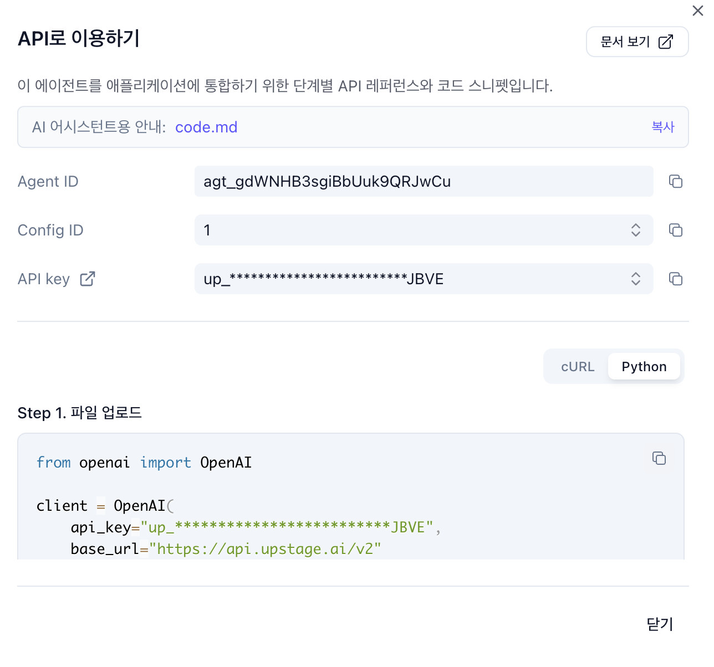

| 항목 | 넣을 곳 |
| --- | --- |
| Agent ID | `.env` 의 `RESUME_AGENT_ID` |
| Config ID | `.env` 의 `RESUME_CONFIG_ID`. 기본값 1 |
| API key | 이미 `.env` 의 `UPSTAGE_API_KEY` 에 있음 |

### 확인

- 이름이 `Resume Agent` 이고 Parse와 `Extract-1` 노드가 연결되어 있습니다.
- `Extract-1` 항목 20개가 표와 이름이 같고 모두 목록으로 설정되어 있습니다.
- 실행 결과 JSON에서 `name`, `skills`, `company` 가 채워졌습니다.
- Agent ID와 Config ID를 메모했습니다.

## 4-3. JD Agent

JD Agent는 채용공고 PDF에서 회사명, 모집 직무, 담당 업무, 필수 기술, 우대 기술, 자격 요건을 뽑아 `jd.json` 을 만듭니다. 만드는 과정은 Resume Agent와 같고 스키마만 다릅니다.

### 만들기

1. `에이전트 만들기` 에서 `문서 정보 추출` 템플릿을 선택하고, 이름을 `JD Agent` 로 바꿉니다.
2. `data/JobDescription.pdf` 를 업로드하고 `자동 설정` 을 선택합니다.
3. 편집기에 Parse와 `Extract-1` 노드가 만들어졌는지 확인합니다.

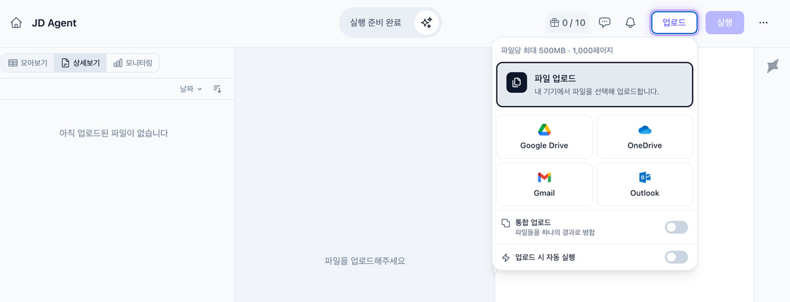

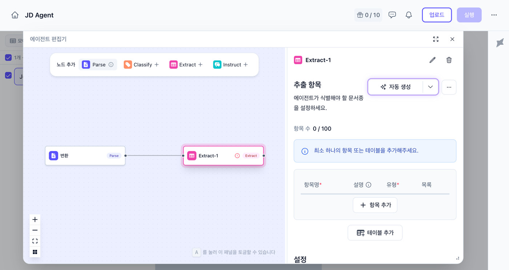

### Extract 스키마

회사명, 직무처럼 하나뿐인 값은 목록을 끄고, 담당 업무와 기술처럼 여러 개인 값은 목록을 켭니다. 유형은 모두 String입니다.

| 항목명 | 설명 | 목록 |
| --- | --- | --- |
| `company_name` | 회사명 | - |
| `position` | 모집직무명 | - |
| `responsibilities` | 담당업무 | 켬 |
| `required_skills` | 필수기술 | 켬 |
| `preferred_skills` | 우대기술 | 켬 |
| `qualifications` | 자격요건 | 켬 |
| `preferred_qualifications` | 우대사항 | 켬 |
| `experience_required` | 요구경력 | - |
| `education_required` | 요구 학력 | - |
| `employment_type` | 고용형태 | - |
| `location` | 근무위치 | - |

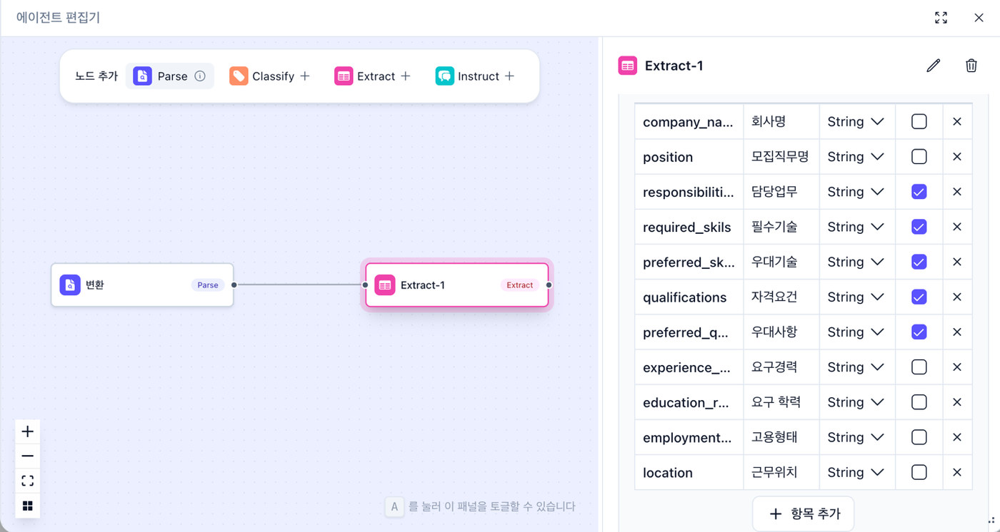

`matching_builder.py` 는 이 표의 이름을 그대로 `jd.get(...)` 으로 읽습니다. 이름이 다르면 PDF에 `-` 만 찍힙니다.

### 실행과 API 정보

`실행` 을 누르고 `JSON` 탭에서 `required_skills` 가 항목별 배열로 들어왔는지 확인합니다. `API로 이용하기` 에서 Agent ID와 Config ID를 복사합니다. `.env` 의 `JD_AGENT_ID`, `JD_CONFIG_ID` 에 넣을 값입니다.

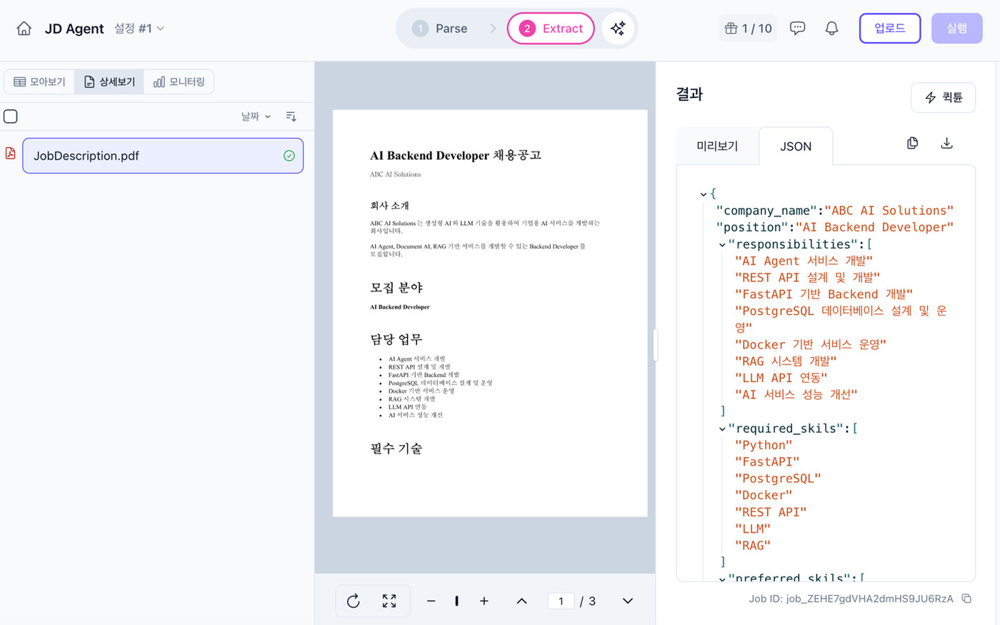

### 확인

- 이름이 `JD Agent` 이고 Parse와 `Extract-1` 노드가 연결되어 있습니다.
- 항목 11개의 이름과 목록 설정이 표와 같습니다.
- 실행 결과에서 `required_skills`, `preferred_skills` 가 배열로 나옵니다.
- Agent ID와 Config ID를 메모했습니다.

## 4-4. Matching Agent

Matching Agent는 `Matching_Input.pdf` 를 읽고 지원자와 채용공고를 비교해 적합도를 평가합니다. 앞의 두 에이전트가 추출이라면 이 에이전트는 평가입니다. 그래서 Parse와 Extract 사이에 Classify 노드가 들어갑니다.

Classify 노드가 문서를 High, Medium, Low Match 중 하나로 분류하고, 분류마다 연결된 Extract 노드가 실행됩니다. 세 Extract 노드는 같은 스키마를 쓰므로 코드는 분류와 상관없이 같은 방식으로 결과를 읽습니다.

### 만들기

1. `에이전트 만들기` 에서 `문서 분류 후 정보 추출` 템플릿을 선택하고, 이름을 `Matching Agent` 로 바꿉니다.
2. 스타터 코드의 샘플 `output/Matching_Input.pdf` 를 업로드하고 `자동 설정` 을 선택합니다. 아직 `app.py` 를 실행하지 않았으므로 이 샘플을 씁니다.
3. 편집기에 Parse, Classify, Extract 노드가 만들어졌는지 확인합니다.

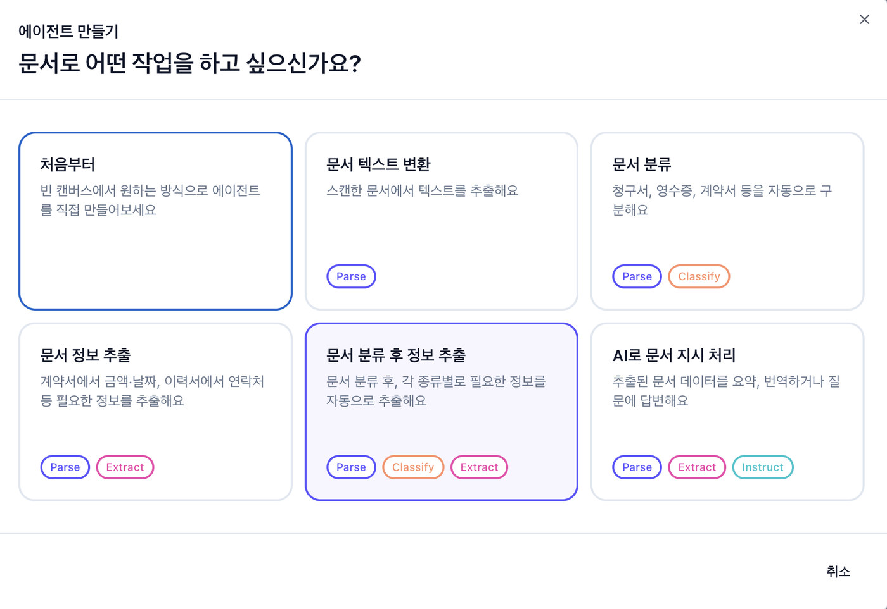

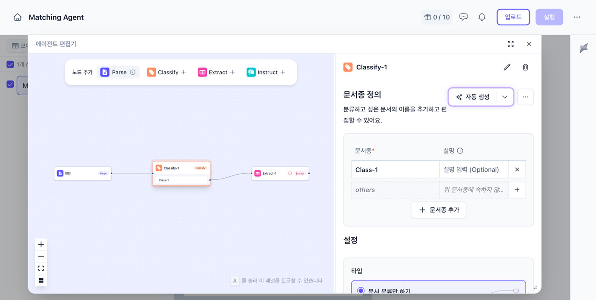

### Classify 노드

`Classify-1` 노드를 선택하고 문서종을 세 가지로 정의합니다. 자동 설정이 만든 문서종은 지우고 아래 표대로 입력합니다. 설명은 AI가 분류할 때 쓰는 기준이므로 명확하게 씁니다.

| 문서종 | 설명 |
| --- | --- |
| High Match | 지원자가 채용 공고와 매우 높은 적합도를 보이는 경우 |
| Medium Match | 일부 요구사항은 충족하지만 보완이 필요한 경우 |
| Low Match | 요구 기술 및 경험이 부족하여 적합도가 낮은 경우 |

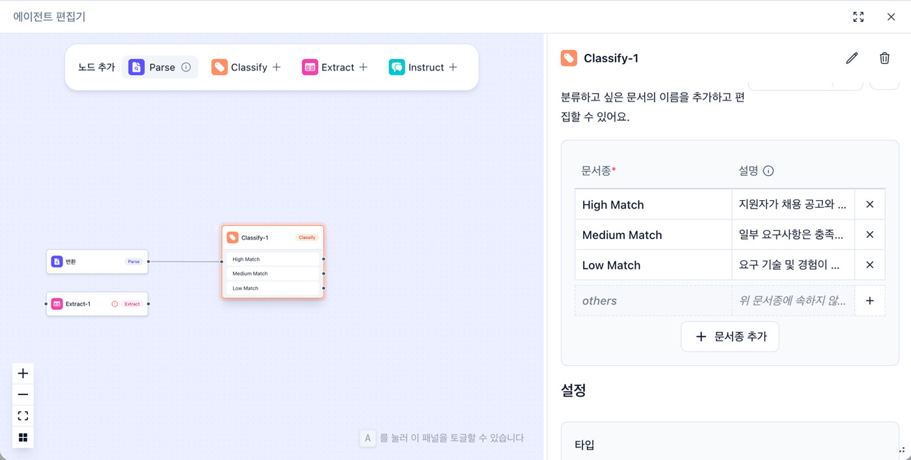

### Extract 스키마

`Classify-1` 의 세 갈래에 각각 Extract 노드를 연결합니다. 노드 이름은 `Extract_HighMatch`, `Extract_MediumMatch`, `Extract_LowMatch` 로 짓고, 세 노드 모두 아래 항목 10개를 넣습니다. `overall_score` 만 Number이고 나머지는 String이며, 목록은 모두 켭니다.

| 항목명 | 설명 |
| --- | --- |
| `match_level` | 최종 적합도 분류. High Match, Medium Match, Low Match |
| `overall_score` | 전체 적합도 점수. 0~100 |
| `summary` | 전체 평가 요약 |
| `matched_skills` | JD와 일치하는 기술 스택 |
| `missing_skills` | JD에는 있으나 Resume에는 없는 기술 |
| `matched_experience` | JD와 일치하는 경력 및 경험 |
| `missing_requirements` | JD의 요구사항 중 부족한 항목 |
| `strengths` | 지원자의 강점 |
| `weaknesses` | 지원자의 보완점 |
| `recommendations` | 개선 및 학습 추천 사항 |

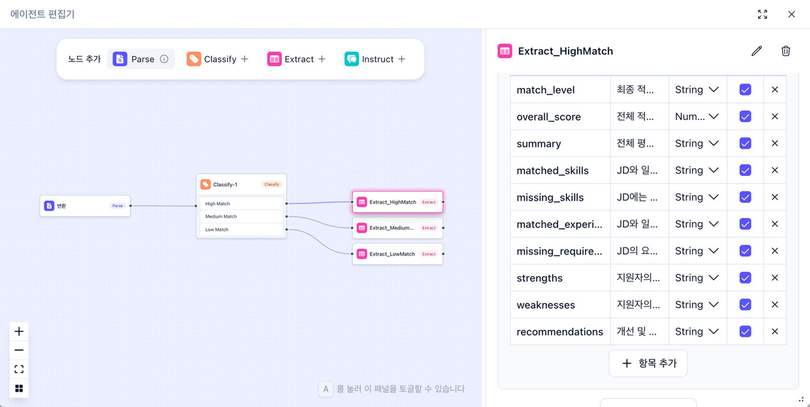

:::note 세 Extract 노드의 스키마
세 Extract 노드의 항목 이름, 유형, 목록 설정을 똑같이 맞춰야 합니다. 한 노드에서만 `missing_skills` 가 빠지거나 목록이 꺼져 있으면 `streamlit_app.py` 가 `KeyError` 로 멈추거나 화면이 달라집니다.
:::

### 실행과 API 정보

`실행` 을 누릅니다. Classify가 Match Level을 정하고 해당 Extract 노드가 평가 결과를 만듭니다. `JSON` 탭에서 `match_level`, `overall_score`, `recommendations` 를 확인합니다.

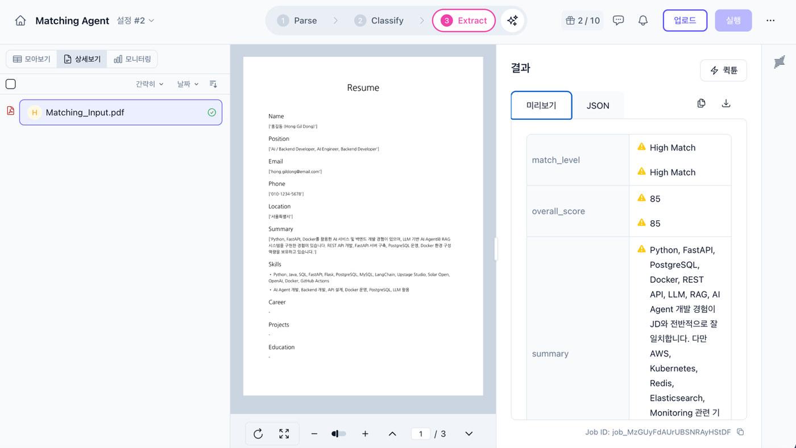

`API로 이용하기` 에서 Agent ID와 Config ID를 복사합니다. `.env` 의 `MATCHING_AGENT_ID`, `MATCHING_CONFIG_ID` 에 넣을 값입니다.

### 확인

- 이름이 `Matching Agent` 이고 Parse, `Classify-1`, Extract 3개 노드가 연결되어 있습니다.
- `Classify-1` 문서종이 High Match, Medium Match, Low Match 세 개입니다.
- Extract 노드 3개의 항목 10개가 모두 같습니다.
- 실행 결과에 `match_level` 과 `overall_score` 가 있습니다.

## 4-5. Agent ID 넣기

메모해 둔 Agent ID와 Config ID를 `.env` 에 넣습니다. Agent ID는 각자 다르므로 아래는 형식 예시입니다.

```TEXT
UPSTAGE_API_KEY=up_xxxxxxxxxxxxxxxxxxxxxxxx

RESUME_AGENT_ID=agt_xxxxxxxxxxxxxxxxxxxxxx
RESUME_CONFIG_ID=1

JD_AGENT_ID=agt_xxxxxxxxxxxxxxxxxxxxxx
JD_CONFIG_ID=1

MATCHING_AGENT_ID=agt_xxxxxxxxxxxxxxxxxxxxxx
MATCHING_CONFIG_ID=1
```

## 4-6. 실행

가상환경이 활성화된 터미널에서 실행합니다.

```bash
python app.py
```

가장 먼저 `print_config()` 가 폴더 경로와 Agent ID를 출력합니다. ID가 `None` 으로 보이면 `.env` 를 다시 확인합니다.

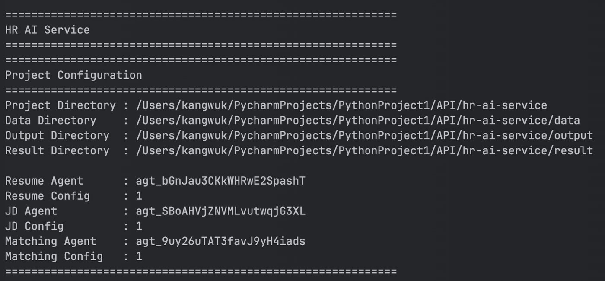

Step 1과 Step 2는 업로드, File ID 발급, Job 생성, 상태 조회, JSON 저장 순서로 출력됩니다. 상태는 2초마다 조회합니다.

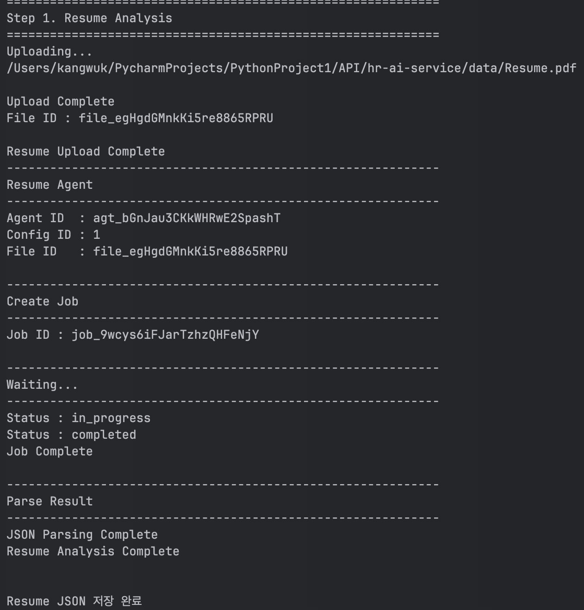

Step 3은 API 호출 없이 로컬에서 PDF를 만듭니다. Step 4는 만든 PDF를 업로드해 Matching Agent를 실행하고 `result/matching_result.json` 을 저장합니다.

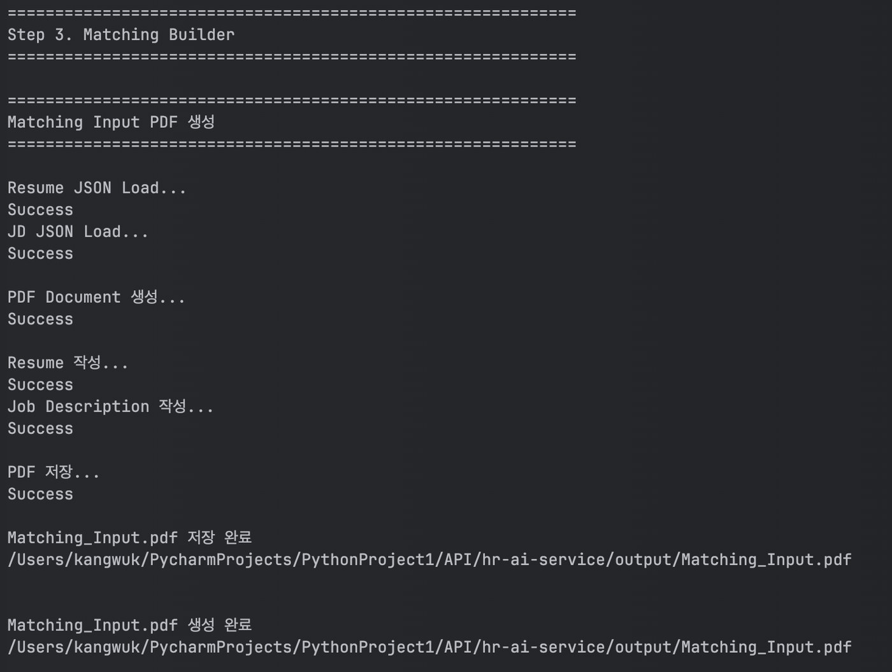

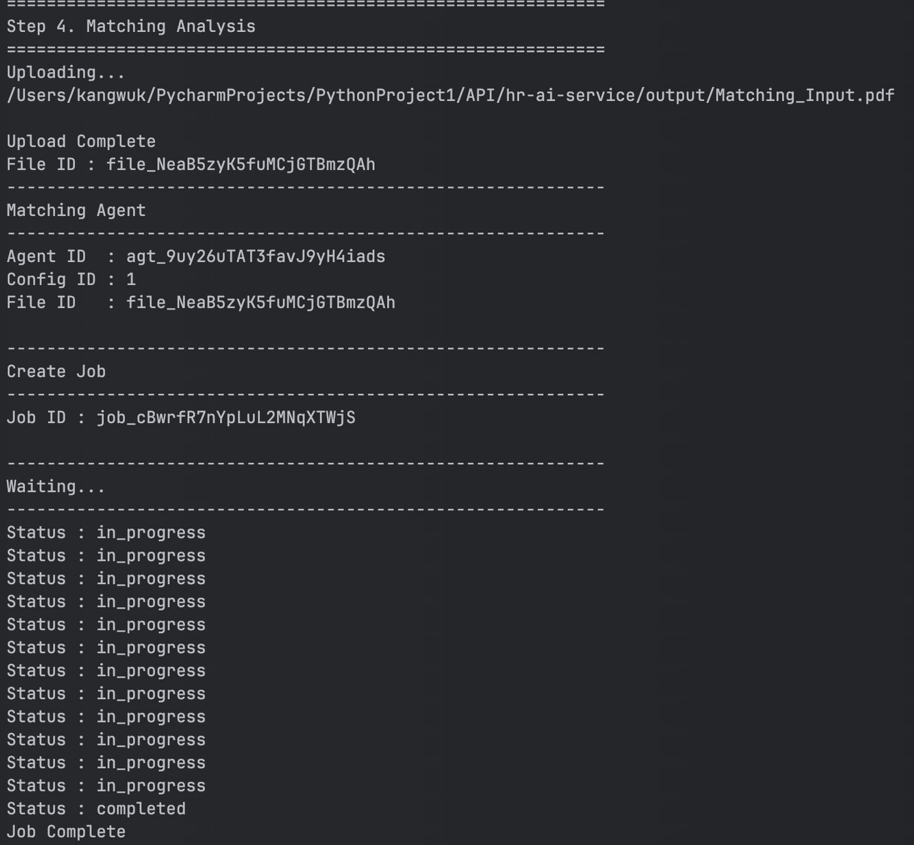

마지막에 `Project Complete` 와 함께 생성된 파일 4개의 경로가 출력됩니다. `output/Matching_Input.pdf` 를 열어 Resume 섹션과 Job Description 섹션이 한 문서에 들어 있는지 확인합니다.

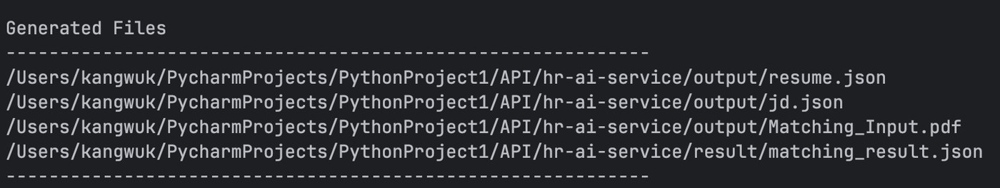

Resume 스키마는 `company`, `career_position`, `career_period` 처럼 항목별로 나뉜 리스트입니다. `group_items()` 가 같은 순서의 값을 하나의 경력으로 묶습니다. 어떤 항목이 `-` 로만 나오면 스키마의 필드 이름과 `group_items()` 에 적은 이름이 다른 것입니다.

## 4-7. 결과 JSON 구조

생성된 JSON은 다음 에이전트의 입력이기도 합니다. 구조를 알아야 문제가 생겼을 때 어느 단계인지 찾을 수 있습니다.

| 파일 | 구조 |
| --- | --- |
| `resume.json` | 모든 필드가 배열입니다. Extract 항목을 모두 목록으로 설정했기 때문입니다 |
| `jd.json` | 하나뿐인 값은 문자열, 여러 개인 값은 배열입니다 |
| `matching_result.json` | 모든 필드가 배열이며 `match_level` 이 첫 필드입니다. 화면 코드는 점수와 등급의 첫 값을 꺼내 씁니다 |

결과가 이상하면 앞에서부터 확인합니다. `resume.json` 이 비어 있으면 Resume Agent 스키마, `Matching_Input.pdf` 에 `-` 가 많으면 `matching_builder.py` 의 필드 이름, `matching_result.json` 에 필드가 빠지면 Matching Agent의 Extract 노드 3개를 확인합니다.

### 확인

- `print_config()` 출력에 Agent ID 3개가 모두 보입니다.
- Step 1~4가 오류 없이 끝나고 `Project Complete` 가 출력됩니다.
- 결과 파일 4개가 새로 생성되었습니다.
- JSON 세 개의 필드 이름이 Studio 스키마와 같습니다.

## 4-8. 내 해커톤에 적용하기

팀이 정한 문서를 기반으로 Studio Document Agent를 만들고 스타터 코드에 연결합니다. 3-7의 기획서를 바탕으로 4-2부터 4-4까지의 과정을 팀 문서로 반복합니다.

### 에이전트 구성

- 팀 서비스에 에이전트가 몇 개 필요한가. 문서 종류마다 추출 에이전트 1개, 비교와 평가용 1개가 기본입니다.
- 각 에이전트의 입력 문서, 노드 구성, 출력 JSON 이름, Studio 템플릿을 4-1의 표처럼 적었는가.
- 테스트용 샘플 문서를 에이전트마다 1개 이상 준비했는가.

| 에이전트 | 입력 문서 | 노드 구성 | 출력 | Studio 템플릿 |
| --- | --- | --- | --- | --- |
| 문서 A 추출 에이전트 | | Parse, Extract | | 문서 정보 추출 |
| 문서 B 추출 에이전트 | | Parse, Extract | | 문서 정보 추출 |
| 평가 에이전트 | 두 JSON을 합친 PDF | Parse, Classify, Extract | | 문서 분류 후 정보 추출 |

### 추출 에이전트 스키마

- 뽑아야 할 항목을 모두 적었는가. 항목명은 코드에서 그대로 읽는 영문 snake_case로 씁니다.
- 항목마다 유형과 목록 여부를 정했는가. 여러 개가 나올 수 있으면 목록으로 둡니다.
- 항목의 설명에 문서 어디를 보고 뽑을지 적었는가. 설명이 추출 정확도를 좌우합니다.
- 문서 A와 문서 B에서 서로 비교할 항목이 대응되는가. 예를 들어 이력서 `skills` 와 공고 `required_skills` 가 대응합니다.
- 비교에 쓰이는 항목이 두 문서에서 같은 목록 형태인가.

### 평가 에이전트 스키마

- 분류 기준을 3개 안팎으로 정하고 각 기준의 설명을 한 문장으로 적었는가.
- 점수, 요약, 일치 항목, 부족 항목, 추천 같은 평가 결과 스키마를 정했는가.
- 분류별 Extract 노드가 모두 같은 스키마인가.

### 코드 수정

팀 문서로 에이전트를 만들었다면 코드에서 손댈 곳은 다음 순서입니다. Studio에서 스키마를 먼저 확정하고, 그 필드 이름을 코드에 맞춰 넣습니다.

| 순서 | 손댈 곳 | 무엇을 바꾸나 | HR 예시의 값 |
| --- | --- | --- | --- |
| 1 | Studio 에이전트 | 문서에 맞는 Extract 스키마, Classify 기준, 세 Extract 노드의 공통 스키마 | Resume 20필드, JD 11필드, Matching 10필드 |
| 2 | `agent_configs/*.json` | Studio에서 새 에이전트 설정을 내보내 교체 | `Resume Agent.json` 등 3개 |
| 3 | `config.py` | 입력 파일 이름, 출력 파일 이름, 폴더 경로 | `RESUME_FILE = DATA_DIR / "Resume.pdf"` |
| 4 | `matching_builder.py` | `add_resume()`, `add_job_description()` 의 `get("필드명")` 을 새 스키마 이름으로 | `resume.get("skills")`, `jd.get("required_skills")` |
| 5 | `.env` | 새 에이전트 3개의 Agent ID와 Config ID | 변수 7개 |

`agent_client.py`, `upload.py`, `app.py`, `service.py`, `file_manager.py` 는 바꾸지 않아도 됩니다. 호출 방식과 실행 순서는 주제와 무관합니다.

필드 이름을 바꿀 때는 Studio 스키마, `agent_configs`, `matching_builder.py`, `streamlit_app.py` 순서로 검색해 한 이름씩 따라갑니다. 이름이 어긋나면 오류 없이 빈 값 `-` 만 나와 알아채기 어렵습니다.

### 확인

- 팀 에이전트가 Studio에서 샘플 문서로 끝까지 실행되고 결과 JSON 항목이 모두 채워집니다.
- `python app.py` 실행 후 결과 파일 4개가 생기고, 합친 PDF에 `-` 로만 찍힌 항목이 없습니다.

# 5. Streamlit 서비스

`python app.py` 는 개발자용 실행입니다. 서비스 사용자는 브라우저에서 파일을 올리고 버튼을 누릅니다.

```TEXT
streamlit_app.py (화면) → service.py (서비스) → app.py 함수 → 에이전트
```

## 5-1. 화면 구성

| 영역 | 역할 | 코드 |
| --- | --- | --- |
| Sidebar | 서비스 이름과 소개 | `with st.sidebar:` |
| Header | 제목과 캡션 | `st.title`, `st.caption` |
| Upload | Resume PDF, Job Description PDF 업로드 | `st.file_uploader` 2개 |
| Analyze | 분석 실행 버튼 | `st.button` |
| Result | 점수, 요약, 기술, 강약점, 추천, JSON, 다운로드 | `st.metric`, `st.subheader`, `st.json`, `st.download_button` |

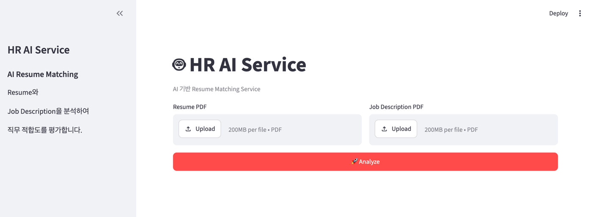

## 5-2. service.py

`service.py` 는 화면과 `app.py` 사이의 서비스 계층입니다. `run_matching_service(resume_path, jd_path)` 하나가 Step 1~4를 순서대로 호출하고 결과 dict를 돌려줍니다.

| 함수 | 역할 |
| --- | --- |
| `analyze_resume_document(resume_path)` | Resume 분석, `output/resume.json` 저장 |
| `analyze_jd_document(jd_path)` | JD 분석, `output/jd.json` 저장 |
| `build_matching_document()` | `output/Matching_Input.pdf` 생성 |
| `analyze_matching(matching_pdf)` | `result/matching_result.json` 저장 |
| `load_matching_result()` | 결과 파일을 다시 읽음 |
| `run_matching_service(resume_path, jd_path)` | 위 함수를 순서대로 실행하고 결과 dict 반환 |

화면 코드에는 API 호출이 없습니다. 화면, 서비스, 워크플로우로 책임이 나뉘어 있어 화면을 그대로 두고 뒤쪽만 바꿀 수 있습니다.

## 5-3. streamlit_app.py

업로드된 파일을 임시 PDF로 저장하고 `run_matching_service()` 를 호출한 뒤 결과를 그립니다. 분석 중에는 `st.spinner` 로 진행 상태를 보여 주고, 끝나면 임시 파일을 지웁니다.

| 위치 | 내용 |
| --- | --- |
| `tempfile.NamedTemporaryFile(suffix=".pdf", delete=False)` | 업로드된 바이트를 임시 PDF로 저장. `upload_file()` 이 경로를 받기 때문 |
| `if isinstance(overall_score, list): overall_score = overall_score[0]` | Extract 결과가 배열이므로 첫 값을 꺼냄 |
| `for item in result["matched_skills"]: st.success(item)` | 배열 항목을 하나씩 출력. 필드 이름은 Matching Agent 스키마와 같아야 함 |

## 5-4. 실행과 사용 흐름

프로젝트 루트에서 실행합니다. 터미널에 `Local URL: http://localhost:8501` 이 출력되고 브라우저가 열립니다.

```bash
streamlit run streamlit_app.py
```

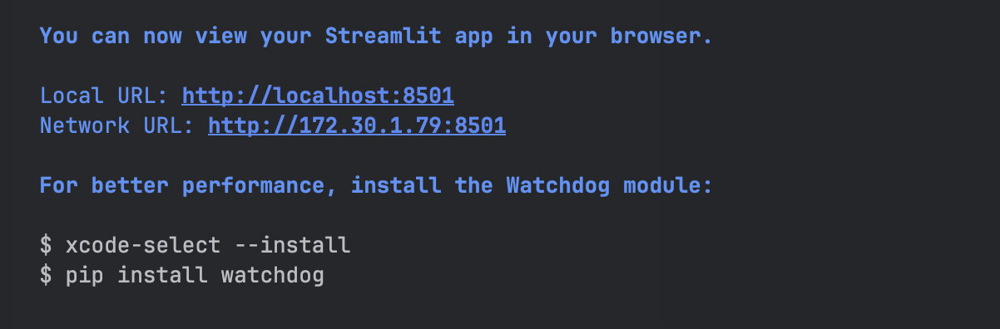

1. Resume PDF와 Job Description PDF를 각각 업로드합니다. 둘 중 하나라도 없으면 오류 메시지가 뜨고 멈춥니다.
2. `Analyze` 를 누릅니다. 분석 중에는 `AI가 문서를 분석하고 있습니다...` 스피너가 표시되고, 터미널에는 `app.py` 를 직접 실행했을 때와 같은 로그가 찍힙니다.
3. 분석이 끝나면 점수, 등급, 요약, 기술, 강점과 약점, 추천, JSON 순서로 결과가 표시됩니다.
4. 맨 아래 `Download JSON` 으로 결과를 내려받습니다.

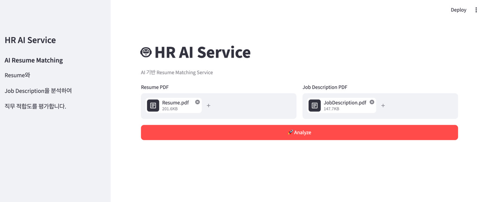

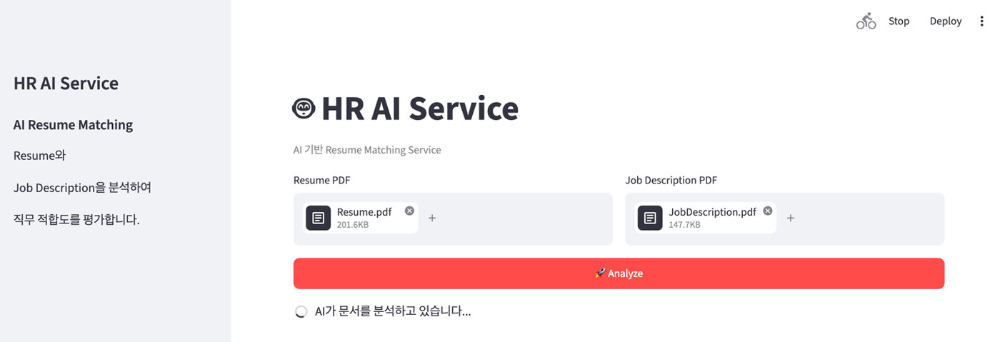

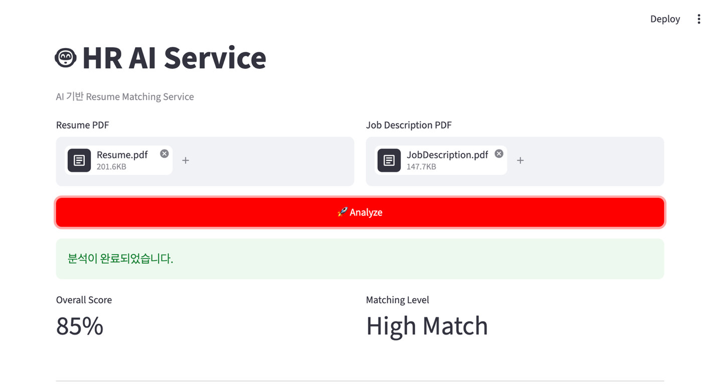

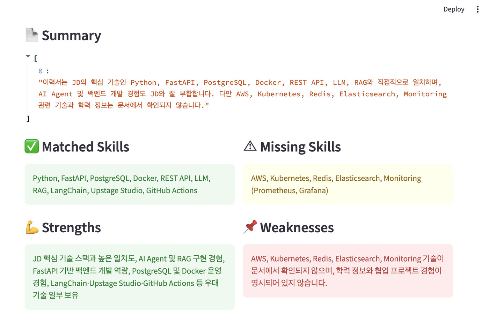

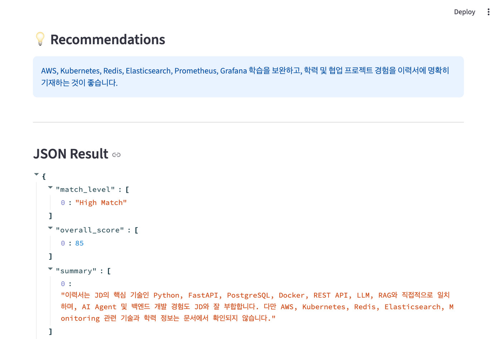

코드를 수정하면 브라우저 오른쪽 위에 `Rerun` 안내가 뜹니다. 서버를 다시 켜지 않고 페이지만 새로고침하면 반영됩니다.

### 확인

- `http://localhost:8501` 에서 사이드바, 제목, 업로드 2개, `Analyze` 버튼이 보입니다.
- 파일 없이 `Analyze` 를 누르면 오류 메시지가 뜹니다.
- 두 PDF를 올리고 `Analyze` 를 누르면 결과와 JSON이 표시됩니다.
- `Download JSON` 으로 받은 파일이 `result/matching_result.json` 과 같습니다.

## 5-5. 내 해커톤에 적용하기

서비스 화면은 Streamlit이 아니어도 됩니다. 팀 서비스의 사용자와 사용 흐름에 맞는 화면을 구상합니다.

어떤 도구로 만들든 화면은 문서를 받고, `service.py` 의 `run_matching_service()` 처럼 워크플로우를 호출하고, 결과 JSON을 보여 주는 역할만 맡습니다. 에이전트 호출 코드는 그대로 둡니다.

- 서비스 사용자는 누구이고, 화면에서 무엇을 가장 먼저 봐야 하는가.
- 입력은 무엇인가. 업로드할 문서 수, 파일 형식 제한, 라벨 문구를 팀 문서 이름으로 정했는가.
- 결과 화면에 보여 줄 항목과 순서를 정했는가.
- 단일 값처럼 보여 줄 항목과 목록으로 보여 줄 항목을 구분했는가. Extract 결과는 모두 배열입니다.
- 화면 코드가 읽는 필드 이름을 팀 평가 스키마 이름과 맞췄는가.
- 파일 없이 실행했을 때, 에이전트가 실패했을 때 보여 줄 메시지를 정했는가.
- 결과를 내려받거나 공유할 방법이 있는가.

| 구상할 것 | HR 예시 | 팀 서비스 |
| --- | --- | --- |
| 화면 도구 | Streamlit | |
| 입력 | Resume PDF, Job Description PDF 업로드 | |
| 실행 버튼 문구 | `Analyze` | |
| 핵심 결과 | `overall_score`, `match_level` | |
| 상세 결과 | `matched_skills`, `missing_skills`, `strengths`, `weaknesses`, `recommendations` | |

# 6. Railway 배포

`localhost:8501` 은 내 컴퓨터에서만 열립니다. Railway는 GitHub 저장소를 연결하면 빌드와 배포를 자동으로 하는 클라우드 플랫폼입니다.

```TEXT
GitHub 저장소 준비 → Railway 로그인 → New Project → GitHub 연결 → 자동 빌드 → Variables 등록 → Custom Start Command → Redeploy → Generate Domain → 접속 확인
```

첫 배포는 환경변수와 실행 명령이 없어서 실패하는 것이 정상입니다. 환경변수와 Start Command를 넣은 뒤 다시 배포합니다.

## 6-1. GitHub 저장소 준비

Railway는 GitHub 저장소를 복제해서 빌드합니다. 스타터 코드를 저장소로 만들어 올립니다.

```bash
git init
git add .
git commit -m "HR AI Service MVP"
git branch -M main
git remote add origin https://github.com/<계정>/hr-ai-service.git
git push -u origin main
```

| 확인 항목 | 이유 |
| --- | --- |
| `git status` 에 `.env` 가 보이지 않음 | API Key 유출 방지 |
| `requirements.txt` 가 최신 | Railway가 이 파일로 패키지를 설치 |
| `fonts/NanumGothic-Regular.ttf` 포함 | PDF 한글 출력에 필요 |
| `output/`, `result/` 는 제외되어도 됨 | 실행할 때 다시 만들어짐 |

:::note .env를 커밋한 경우
실수로 `.env` 를 커밋했다면 GitHub에서 지우는 것만으로는 부족합니다. Upstage Console에서 API Key를 재발급해야 합니다.
:::

## 6-2. 프로젝트 생성과 자동 빌드

1. Railway에 GitHub 계정으로 로그인합니다.
2. 대시보드 오른쪽 위 `New` 를 누르고 `GitHub Repository` 를 선택합니다.
3. 저장소 목록에서 올린 저장소를 선택합니다. 연결하는 순간 Railway가 저장소를 복제하고 빌드를 시작합니다.

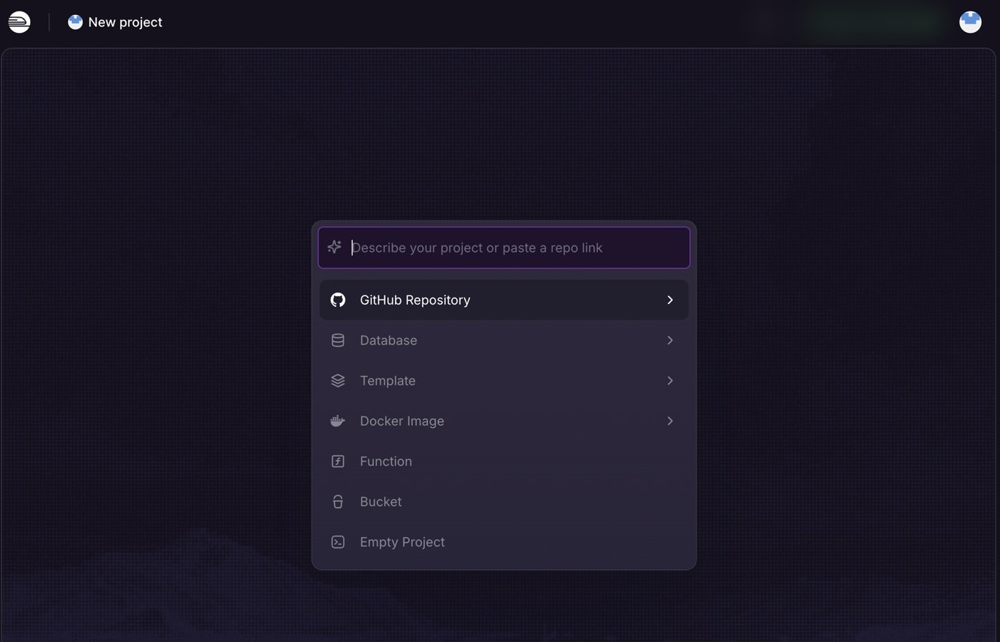

## 6-3. 환경변수 등록

서비스의 `Variables` 메뉴를 엽니다. Railway가 코드를 분석해 필요한 변수를 `Suggested Variables` 로 보여 줍니다. `.env` 와 같은 7개를 등록합니다.

| Variable | 값 |
| --- | --- |
| `UPSTAGE_API_KEY` | Upstage API Key |
| `RESUME_AGENT_ID` | Resume Agent ID |
| `RESUME_CONFIG_ID` | 1 |
| `JD_AGENT_ID` | JD Agent ID |
| `JD_CONFIG_ID` | 1 |
| `MATCHING_AGENT_ID` | Matching Agent ID |
| `MATCHING_CONFIG_ID` | 1 |

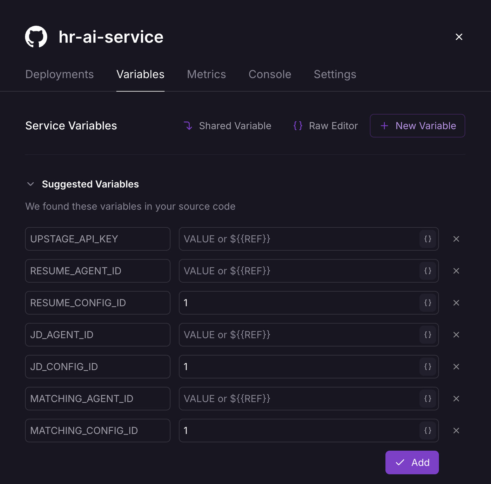

등록이 끝나면 값은 가려집니다. 변수 이름 오타와 7개가 모두 있는지 확인합니다. 코드는 `os.getenv()` 로 값을 읽으므로 로컬과 Railway에서 같은 코드가 그대로 동작합니다.

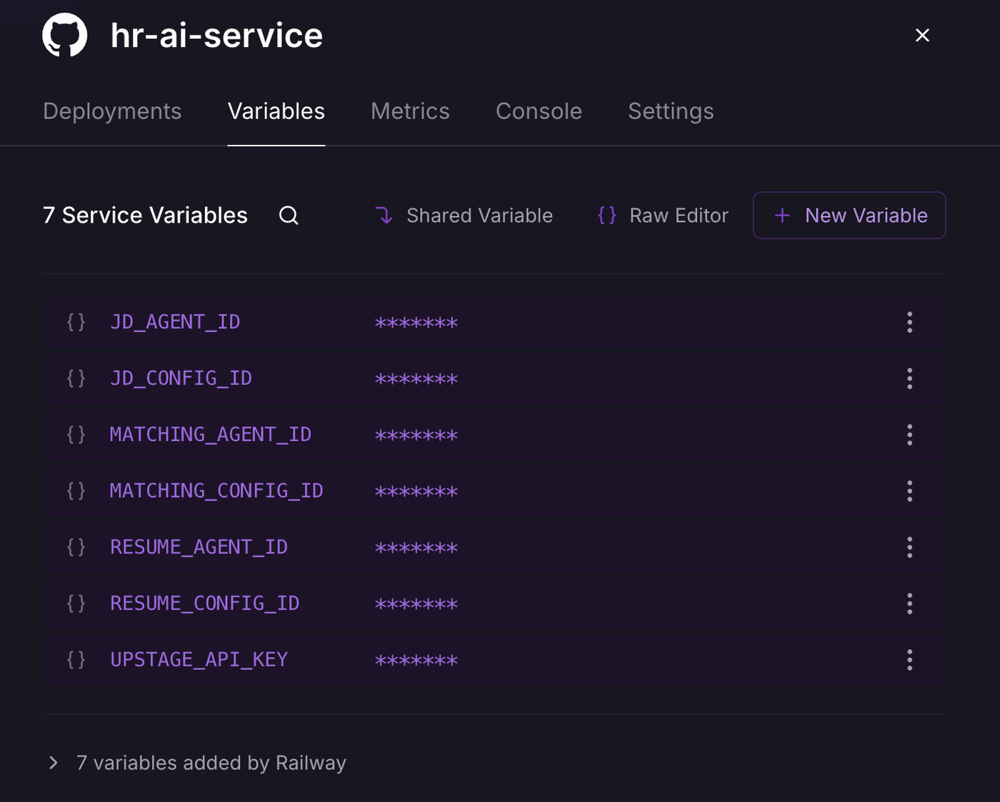

## 6-4. Custom Start Command

`Settings → Deploy → Custom Start Command` 에 다음 명령을 입력합니다.

```bash
streamlit run streamlit_app.py --server.port=$PORT --server.address=0.0.0.0
```

| 옵션 | 의미 |
| --- | --- |
| `--server.port=$PORT` | Railway가 할당한 포트 사용. 8501로 두면 시작되지 않습니다 |
| `--server.address=0.0.0.0` | 외부 네트워크에서 접근 허용 |

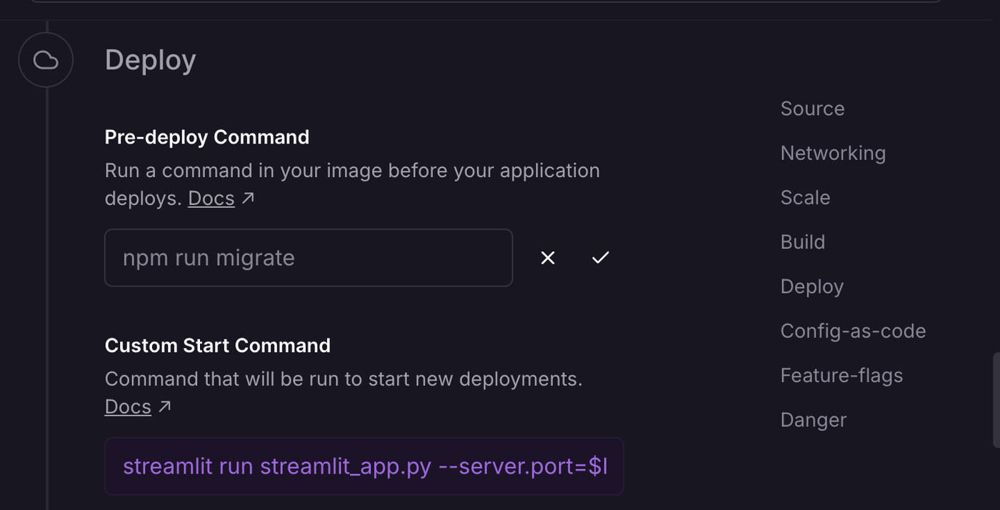

## 6-5. Redeploy와 로그 확인

Variables나 Start Command를 바꾸면 Railway가 재배포를 시작합니다. 시작되지 않으면 `Deployments` 에서 `Redeploy` 를 누릅니다.

`Deploy Logs` 에서 Streamlit이 시작되었는지 확인합니다. 상태가 Online이면 정상 실행 중입니다.

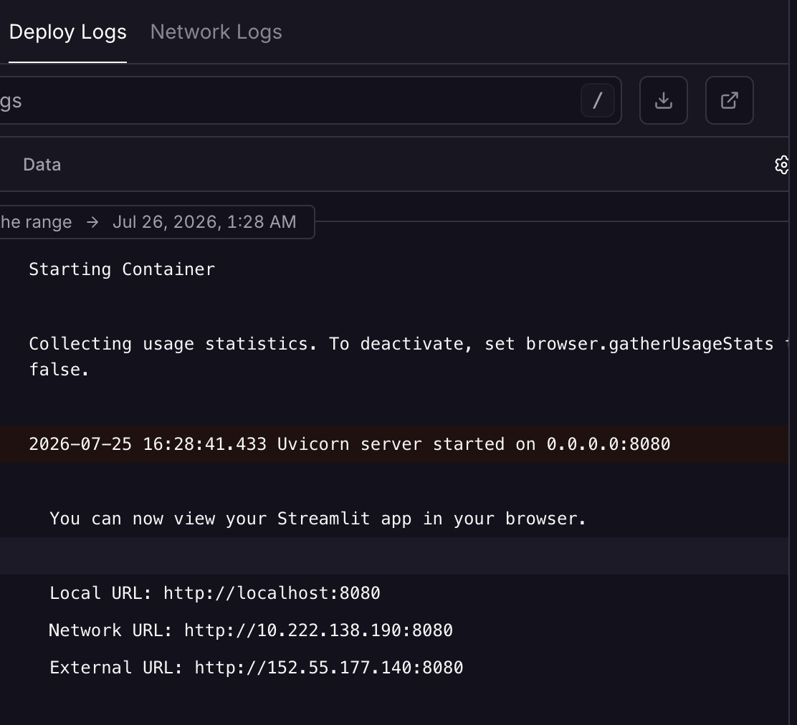

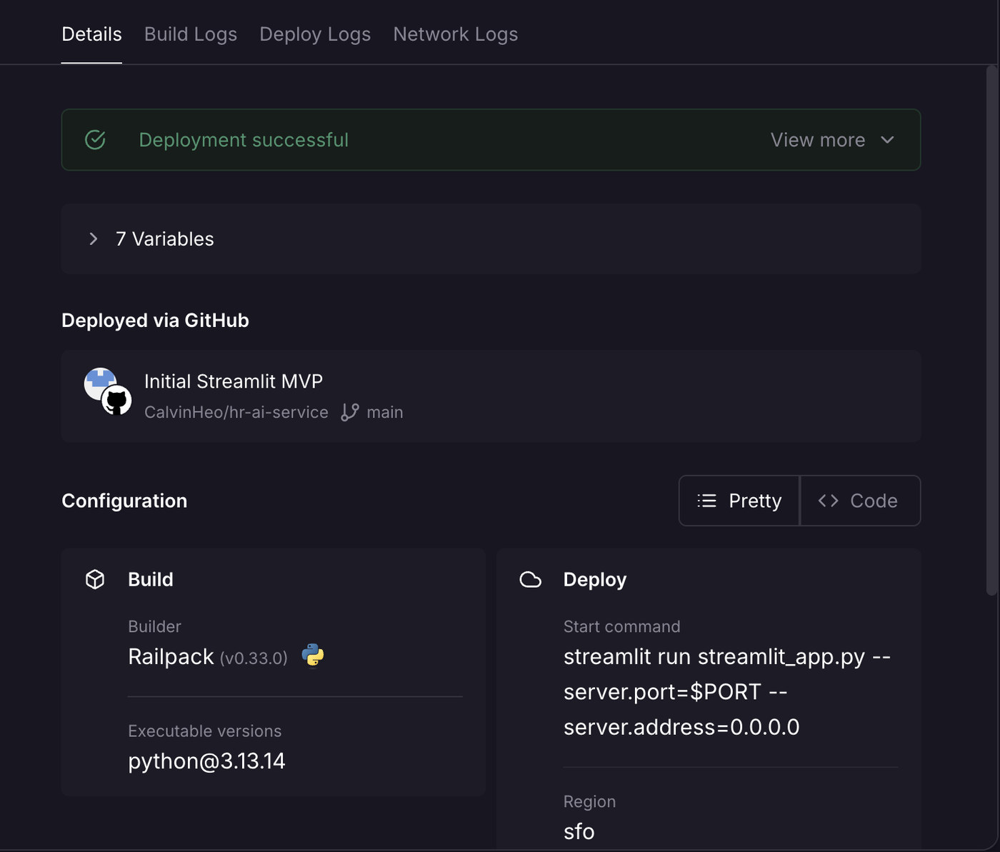

## 6-6. Public Domain 생성

배포가 끝나도 주소는 자동으로 생기지 않습니다. `Settings → Networking → Generate Domain` 을 눌러 Public URL을 만듭니다.

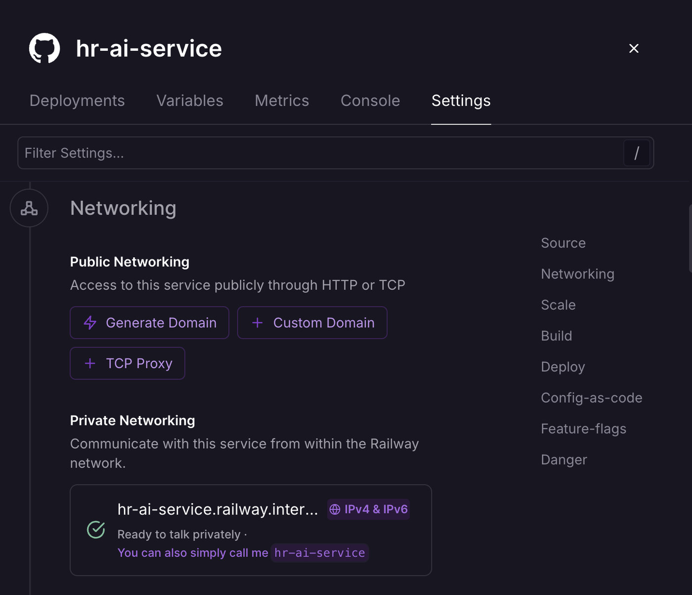

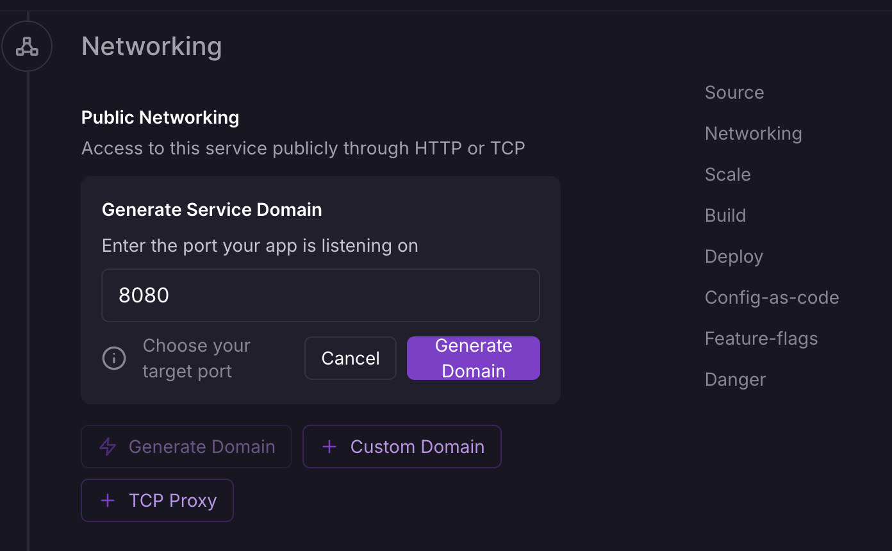

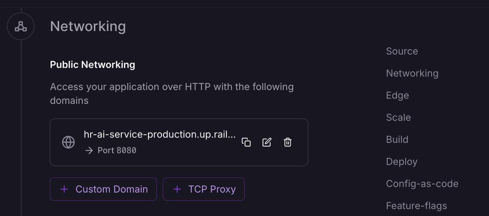

## 6-7. 접속 확인

생성된 URL을 브라우저에 입력합니다. 로컬과 같은 화면이 뜨면 두 PDF를 올리고 `Analyze` 를 눌러 결과까지 확인합니다.

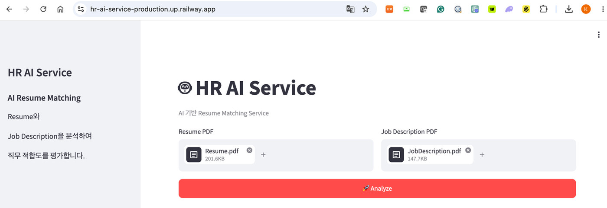


이후에는 `git push` 만 하면 Railway가 자동으로 다시 빌드하고 배포합니다.

### 확인

- GitHub 저장소에 `.env` 가 없습니다.
- Railway Variables에 7개가 등록되어 있습니다.
- Start Command에 `$PORT` 와 `0.0.0.0` 이 들어 있습니다.
- Public URL에서 `Analyze` 결과가 표시됩니다.

## 6-8. 내 해커톤에 적용하기

완성된 팀 서비스를 배포해 누구나 접속할 수 있는 공개 URL을 만듭니다. 6-1부터 6-7까지의 절차를 팀 저장소로 반복합니다.

- GitHub 저장소가 Public이고 `.env` 는 제외되어 있는가.
- `requirements.txt` 에 팀이 추가한 패키지가 모두 있는가.
- `.env` 의 변수를 Railway Variables에 같은 이름으로 모두 등록했는가. 팀 에이전트 수에 따라 개수가 달라집니다.
- Streamlit이 아닌 화면을 만들었거나 파일 이름을 바꿨다면 Start Command를 그 실행 명령으로 바꿨는가.
- 팀원이 아닌 사람의 컴퓨터에서 공개 URL로 업로드부터 결과까지 확인했는가.

# 7. 해커톤 미션

미션은 팀 주제로 문서 워크플로우 MVP를 완성하는 것입니다. 각 장의 `내 해커톤에 적용하기` 절을 차례로 마치면 필수 부분이 끝납니다. 3-7의 기획서, 4-8의 팀 에이전트, 5-5의 팀 화면, 6-8의 공개 URL이 차례로 쌓입니다.

```TEXT
3-7 기획서 → 4-8 Studio Document Agent → 5-5 서비스 화면 → 6-8 공개 URL → 고도화 포인트 선택 적용
```

필수 요건을 먼저 끝내고 고도화에 들어갑니다. 화면이 화려해도 에이전트가 불안정한 서비스보다, 단순해도 어떤 문서를 넣어도 끝까지 동작하는 서비스가 좋은 MVP입니다.

## 7-1. 필수 요건

| 요건 | 기준 | HR 서비스 |
| --- | --- | --- |
| 기획서 | 템플릿 네 항목에 에이전트 구성과 화면 항목을 더해 작성 | 3-6의 HR 기획서 예시 |
| Studio 에이전트 | 추출 에이전트와 평가 에이전트가 샘플 문서로 끝까지 실행되고 결과 JSON 항목이 모두 채워짐 | Resume Agent, JD Agent, Matching Agent |
| 코드 연결 | `agent_configs/`, `config.py`, `matching_builder.py`, `.env` 를 팀 스키마로 바꿔 `python app.py` 가 결과 파일을 만듦 | `.env` 변수 7개, 설정 JSON 3개 |
| 화면 | 업로드, 실행, 결과 표시, JSON 다운로드가 브라우저에서 동작 | 업로더 2개와 `Analyze` |
| 배포 | 공개 URL에서 팀원이 아닌 사람이 문서를 올려 결과를 받음 | Railway Public URL |
| 저장소 | GitHub에 코드가 있고 `.env` 는 제외. README에 서비스 소개, 실행 방법, 에이전트 구성 | 스타터의 `README.md` 구조 |
| 테스트 | 서로 다른 샘플 문서 3개 이상으로 실행해 매번 결과가 나옴 | 형식이 다른 이력서 3장 |

## 7-2. 고도화 포인트

필수 요건을 채웠다면 팀 서비스에 맞는 항목을 고릅니다. 한 항목을 끝낼 때마다 로컬 실행, 커밋, 배포 확인을 반복합니다.

### 서비스 정체성

서비스 이름, 한 줄 소개, 사이드바 설명, 하단 푸터를 팀 서비스 기준으로 정리합니다.

손댈 곳은 `streamlit_app.py` 의 `st.set_page_config(page_title=...)`, `st.title`, `st.caption`, `with st.sidebar:` 블록입니다. 브라우저 탭 제목, 화면 제목, 사이드바, 푸터가 모두 같은 이름을 쓰는지 확인합니다.

### 입력 경험

업로더 라벨을 문서 이름으로 바꾸고 허용 형식과 크기 안내를 붙입니다. 실행 버튼 문구는 서비스가 하는 일을 말하게 합니다. 예: `계약서 검토 시작`

손댈 곳은 `st.file_uploader(label, type=[...], help=...)` 와 `st.button(...)` 입니다.

### 결과 화면

평가 스키마 항목 중 화면에 없는 것을 추가하고, 항목이 많으면 `st.tabs` 로 나눕니다. 점수는 게이지, 일치와 부족 항목은 막대 차트로 보여 주면 한눈에 읽힙니다. 분석에 걸린 시간도 함께 표시합니다.

차트는 Plotly나 Altair, 시간은 `time.perf_counter()` 로 측정합니다. 결과 JSON의 모든 항목이 화면 어딘가에 나오는지 확인합니다.

### 에이전트 품질

결과가 밋밋하면 코드가 아니라 Studio를 고칩니다. Extract 항목 설명을 구체적으로 쓰고, Classify 기준 설명이 서로 겹치지 않게 다듬습니다. 서술형 피드백이 필요하면 Instruct 노드를 추가합니다.

항목 이름은 코드가 읽는 이름이므로 바꾸지 않습니다. 바꿨다면 `agent_configs/` 를 다시 내보냅니다. 같은 샘플 문서로 수정 전후 결과를 비교합니다.

### 안정성과 진행 표시

정상 입력 외의 상황에 안내 메시지를 보여 주고, 분석 중에는 단계별 진행 상태를 보여 줍니다. 진행 표시는 `st.spinner` 대신 `st.status` 나 `st.progress` 를 쓰고, 단계를 나누려면 `service.py` 의 4단계를 개별 호출합니다.

| 상황 | 기대 동작 |
| --- | --- |
| 파일을 올리지 않고 실행 | 어떤 파일이 빠졌는지 안내 |
| 형식이 다른 파일 | 업로더에서 차단, 크기 제한 안내 |
| 에이전트 실패 | 원인과 재시도 안내, 화면이 멈추지 않음 |
| 네트워크나 API 오류 | 오류 메시지 표시 후 다시 실행 가능 |
| 분석 중 | 문서 A 분석, 문서 B 분석, 비교, 보고서 단계가 순서대로 보임 |

### 결과 활용

결과를 JSON뿐 아니라 PDF 보고서로 내려받게 하고, 최근 분석 이력을 남깁니다. `file_manager.py` 의 PDF 저장 함수와 `st.download_button` 을 쓰고, 이력은 `st.session_state` 나 타임스탬프 파일로 저장합니다.

### 사용자 폭 넓히기

한국어와 영어 전환, Light와 Dark 테마를 지원합니다. 문자열을 dict로 분리하고 사이드바에서 언어를 고르게 하며, 테마는 `.streamlit/config.toml` 의 `[theme]` 에서 설정합니다.

### HR 서비스에 적용한 예

| 고도화 포인트 | HR 서비스에서의 예 |
| --- | --- |
| 서비스 정체성 | 이름을 Job Fit Analyzer로, 푸터에 Powered by Upstage와 고려대 세종캠 팀 이름 |
| 결과 화면 | `matched_experience`, `missing_requirements` 추가, 점수 게이지, 기술 막대 차트 |
| 에이전트 품질 | `recommendations` 설명을 실행 가능한 문장 3개로 |
| 안정성 | 이력서만 올리고 실행하면 채용공고 PDF를 올리라는 안내 |
| 결과 활용 | 매칭 보고서 PDF, 최근 분석 5건 이력 |

## 7-3. 구조 확장

에이전트를 새로 만들거나 여러 문서를 다루는 구조 변경입니다. 모두 에이전트를 여러 번 호출하고 결과를 코드로 모으는 패턴이며, 에이전트 하나가 문서 하나를 JSON으로 바꾼다는 단위는 변하지 않습니다.

| 확장 | 내용 | 손댈 곳 |
| --- | --- | --- |
| 추가 질문 피드백 | 결과를 본 사용자가 후속 질문을 하면 문서를 근거로 답합니다 | Instruct 노드가 있는 에이전트 추가, `agent_client.py` 로 호출 |
| 다중 문서 비교 | 문서 A 여러 개를 문서 B 하나와 비교해 순위를 매깁니다 | `service.py` 에서 반복 호출, 결과를 표로 정렬 |
| 일괄 분석 | 폴더 단위로 문서를 분석하고 CSV로 저장합니다 | `app.py` 를 반복 실행하는 스크립트 |

# 부록 A. 문제 해결

대부분의 오류는 코드가 아니라 환경, 설정, 외부 서비스 연동에서 생깁니다. 오류 메시지를 그대로 읽고 표에서 같은 증상을 찾습니다.

### Python 환경

| 증상 | 원인 | 해결 |
| --- | --- | --- |
| `ModuleNotFoundError: No module named 'streamlit'` | 패키지 미설치, 가상환경 비활성화 | 가상환경 활성화 후 `pip install -r requirements.txt` |
| 최신 문법에서 오류 | Python 3.11 미만 | `python --version` 확인, 3.11 이상 설치 |
| `python: command not found`, 다른 Python 실행 | PATH나 가상환경 문제 | `.venv` 활성화 후 `which python` 으로 경로 확인 |
| 설치했는데 `ModuleNotFoundError` | 가상환경 밖에 설치됨 | 가상환경 활성화 상태에서 다시 설치 |

### 환경변수

| 증상 | 원인 | 해결 |
| --- | --- | --- |
| `다음 환경변수가 설정되지 않았습니다.` | `.env` 없음 또는 값이 비어 있음 | `.env.example` 을 복사해 `.env` 생성, 7개 값 입력 |
| `os.getenv()` 가 `None` | 변수 이름 불일치, `.env` 위치 오류 | 이름을 글자 단위로 비교. `.env` 는 `config.py` 와 같은 폴더 |
| Railway에서만 `None` | Railway Variables 미등록 | 같은 이름으로 등록 후 Redeploy |
| `.env` 가 GitHub에 올라감 | `.gitignore` 누락 | `.gitignore` 에 추가, API Key 재발급 |

### Studio 에이전트 연결

| 증상 | 원인 | 해결 |
| --- | --- | --- |
| `Agent Not Found`, 404 | Agent ID 오류 | Studio에서 Agent ID를 다시 복사. 앞뒤 공백 확인 |
| `Configuration Error` | Config ID 오류 | Studio에서 설정 번호 확인. 기본값은 1 |
| `401 Unauthorized` | API Key 오류 | `UPSTAGE_API_KEY` 확인. Console에서 재발급 |
| status `failed` | 입력 PDF 문제 또는 노드 설정 오류 | Studio에서 같은 파일로 직접 실행해 실패 노드 확인. 빈 PDF, 암호화 PDF인지 확인 |
| `output_text가 존재하지 않습니다.` | 마지막 노드 출력이 비어 있음 | 마지막 노드가 Extract 노드인지 확인 |
| `output_text가 JSON 형식이 아닙니다.` | 마지막 노드가 설명문을 함께 출력 | 마지막 노드의 출력을 JSON 스키마로 고정 |
| `Unknown Status : cancelled` | Job이 중간에 취소됨 | 다시 실행. 반복되면 Studio에서 에이전트 상태 확인 |
| `in_progress` 가 오래 계속됨 | 문서 페이지 수가 많거나 대기열 지연 | 테스트는 2~3쪽 PDF로 진행. 조회 간격은 늘려도 됩니다 |
| Matching Agent만 실패 | `Matching_Input.pdf` 생성 오류 | `fonts/NanumGothic-Regular.ttf` 존재 확인, `output/` 의 PDF 확인 |

### OpenAI SDK

| 증상 | 원인 | 해결 |
| --- | --- | --- |
| `AuthenticationError` | Key 또는 `base_url` 오류 | `UPSTAGE_API_KEY` 와 `base_url="https://api.upstage.ai/v2"` 확인 |
| `RateLimitError` 429 | 호출 제한 | 잠시 후 재시도. 동시 실행 줄이기 |
| `PermissionError` | 계정 권한 부족 | Console에서 계정 상태 확인 |
| `FileNotFoundError` | 업로드할 파일 경로 오류 | `data/` 의 파일 위치와 이름 확인 |
| `responses` 속성 없음 | 구버전 SDK | `pip install -U openai`. 1.99 이상 |

### Streamlit

| 증상 | 원인 | 해결 |
| --- | --- | --- |
| `streamlit: command not found` | 미설치, 가상환경 비활성화 | 가상환경 활성화 후 재설치 |
| `Port 8501 is already in use` | 포트 충돌 | 기존 프로세스 종료 또는 `--server.port 8502` |
| `Analyze` 후 오류 | `service.py` 내부 예외 | 터미널 로그 확인. 예외를 `st.error()` 로 표시 |
| `NoneType`, `KeyError` | 결과 JSON에 키가 없음 | `dict.get()` 사용. `output/*.json` 에서 실제 키 확인 |
| `IndexError` | 빈 리스트 접근 | 리스트 길이 확인 후 접근 |
| 결과가 사라짐 | 세션 상태 미저장 | `st.session_state` 에 결과 저장 |

### GitHub

| 증상 | 원인 | 해결 |
| --- | --- | --- |
| `permission denied` | 저장소 권한 부족 | 팀원을 Collaborator로 초대 |
| `Authentication Error` | 비밀번호 대신 토큰 필요 | Personal Access Token 발급 후 비밀번호 자리에 입력 |
| `Repository not found` | remote URL 오류 | `git remote -v` 로 확인 |
| 커밋에 `.env`, `output/` 포함 | `.gitignore` 누락 | `.gitignore` 정리 후 `git rm --cached` |

### Railway

| 증상 | 원인 | 해결 |
| --- | --- | --- |
| `requirements.txt not found` | 파일 누락 또는 하위 폴더 | 루트에 파일을 두거나 Root Directory 설정 |
| Package Error | 패키지 버전 충돌 | 버전 수정 후 Push |
| 빌드 성공 후 바로 종료 | Start Command 미설정 | 6-4의 명령 입력 |
| 배포됐는데 접속 불가 | `$PORT`, `0.0.0.0` 누락 | 6-4의 명령 그대로 사용 |
| Public URL 없음 | 도메인 미생성 | `Settings → Networking` 에서 생성 |
| Deploy Log에 런타임 오류 | 코드 오류 | 로컬에서 같은 오류 재현 후 수정 |

빌드 성공이 배포 성공은 아닙니다. 빌드 뒤에는 Deploy Logs와 Public URL 접속을 확인합니다.

### 디버그 순서

위에서부터 하나씩 확인합니다. 처음 걸리는 곳이 원인입니다.

1. Python 3.11 이상, 가상환경 활성화
2. `pip install -r requirements.txt` 완료
3. `.env` 에 API Key와 Agent ID, Config ID 입력
4. Studio 화면에서 에이전트 3개가 직접 실행되는지 확인
5. `python app.py` 로 결과 파일 생성
6. `streamlit run streamlit_app.py` 로컬 실행
7. GitHub Push 완료
8. Railway Variables 등록, Start Command 설정
9. 빌드 성공, Deploy Logs 확인, Public URL 접속

# 부록 B. 참고 링크

| 항목 | 링크 | 언제 보나 |
| --- | --- | --- |
| Python 가상환경 | https://docs.python.org/3/library/venv.html | 환경을 처음 만들 때 |
| Upstage Console | https://console.upstage.ai | API Key 발급, Studio 진입 |
| Upstage 문서 | https://console.upstage.ai/docs | 노드 옵션과 스키마 문법 |
| OpenAI Python SDK | https://github.com/openai/openai-python | `agent_client.py`, `upload.py` 수정 |
| Streamlit | https://docs.streamlit.io | 화면 수정 |
| Git | https://git-scm.com/docs | Push 오류 |
| Railway | https://docs.railway.com | 배포 오류 |

# 부록 C. 단계별 체크리스트

### 환경 준비

- Python 3.11 이상 설치
- 스타터 코드 `hr-ai-service-workflow/` 준비
- 가상환경 생성과 활성화
- `pip install -r requirements.txt` 완료
- Upstage Console API Key 발급
- `.env` 생성, `UPSTAGE_API_KEY` 입력

### Studio 에이전트

- Resume Agent 생성. Parse, Extract
- JD Agent 생성. Parse, Extract
- Matching Agent 생성. Parse, Classify, Extract 3개
- 각 에이전트를 Studio에서 샘플 PDF로 실행해 JSON 확인
- Agent ID와 Config ID 6개를 `.env` 에 입력

### 로컬 실행

- `python app.py` 오류 없이 종료
- `output/resume.json`, `output/jd.json` 생성
- `output/Matching_Input.pdf` 생성, 한글 깨짐 없음
- `result/matching_result.json` 생성

### Streamlit

- `http://localhost:8501` 접속
- PDF 업로드, `Analyze`, 결과 표시
- 파일 미업로드와 에이전트 실패 시 오류 메시지 표시

### Railway

- GitHub 저장소 생성과 Push. `.env` 제외
- Railway 프로젝트 생성과 저장소 연결
- Variables 7개 등록
- Start Command 설정
- 빌드 성공, Deploy Logs 오류 없음
- Public Domain 생성, 배포 환경에서 `Analyze` 1회 성공

### 해커톤 미션

- 기획서 템플릿 작성
- 팀 문서용 에이전트가 샘플 문서로 끝까지 실행
- 코드를 팀 스키마로 교체하고 `python app.py` 성공
- 화면에서 업로드, 실행, 결과, JSON 다운로드
- 공개 URL에서 외부 사용자 실행 가능
- GitHub 저장소와 README
- 서로 다른 샘플 문서 3개 이상으로 실행 성공
